# Coordinated release candidate lifecycle

This document defines the v0.23+ coordinated release process for MycelDB. It separates release-machinery qualification from product-candidate creation so harness, workflow, provenance, infrastructure, protected-provider, and publication failures do not create artificial product-candidate churn.

## State machine

```mermaid
stateDiagram-v2
  [*] --> Draft
  Draft --> QualificationBundleFrozen: clean sources + digest-locked images + frozen workflows
  QualificationBundleFrozen --> CredentialFreeQualificationRunning: one-shot credential-free approval consumed
  CredentialFreeQualificationRunning --> QualificationPassed: every credential-free gate passed unchanged
  CredentialFreeQualificationRunning --> QualificationFailed: any gate, provenance, cleanup, or redaction failure
  QualificationFailed --> Draft: harness/workflow/process/infra fix resets qualification only
  QualificationPassed --> CandidateConstructed: assign first numbered candidate
  CandidateConstructed --> ProtectedAcceptanceRunning: protected/live approval consumed
  ProtectedAcceptanceRunning --> CandidateAccepted: protected gates passed or non-gating live evidence recorded
  ProtectedAcceptanceRunning --> CandidateFailedProduct: product correctness failure
  ProtectedAcceptanceRunning --> CandidateFailedNonProduct: harness/identity/infra/provider failure
  CandidateFailedProduct --> Draft: product snapshot changes; new candidate number after requalification
  CandidateFailedNonProduct --> QualificationBundleFrozen: fix non-product machinery; keep product payload identity
  CandidateAccepted --> PublicationPlanned: reviewed coordinated release manifest frozen
  PublicationPlanned --> Published: stable tags/packages/images/artifacts created once
  PublicationPlanned --> RiskAcceptedPublication: explicit risk acceptance for failed non-product gate
  RiskAcceptedPublication --> Published: manifest records failed evidence and limitations
  Published --> [*]
```



## State contracts

| State | Candidate numbering | Required machine-readable evidence | Mutation allowed |
| --- | --- | --- | --- |
| `Draft` | none | reviewed source heads, intended workflow changes, image build plan | source/harness/workflow changes |
| `QualificationBundleFrozen` | unnumbered | release execution bundle with `lifecycle.phase: qualification`, `candidateNumbering: unnumbered`, digest-locked images, bound workflow/scenario hashes | no; any change returns to `Draft` |
| `CredentialFreeQualificationRunning` | unnumbered | one-shot `credential-free-qualification` approval and bundle SHA-256 | disposable Lab resources only |
| `QualificationPassed` | unnumbered | retained passing gate artifacts, cleanup, final oracle, redaction, bundle SHA-256 | no |
| `CandidateConstructed` | numbered starts here | bundle/manifest references `qualifiedBundleSHA256` from `QualificationPassed` | candidate payload immutable |
| `ProtectedAcceptanceRunning` | numbered | one-shot `protected-release-gate` or `protected-live-provider` approval, protected workflow/run identity, exact source/image digests | disposable resources and bounded provider calls only |
| `CandidateAccepted` | numbered | passing or explicitly non-gating protected evidence | no |
| `PublicationPlanned` | numbered | coordinated release manifest with all outputs and approvals | no; manifest changes require review and new digest |
| `RiskAcceptedPublication` | numbered | risk-acceptance block naming failed gate, evidence, digests, limitations, and publication scope | only declared publication scope |
| `Published` | stable version | immutable Git tags, OCI tags, packages, Console artifacts, checksums, release notes, verification evidence | no stable-tag mutation; corrections use a new patch version |

## Failure domains

Release evidence records exactly one primary failure domain for a failed gate or publication step:

- `product-correctness` — daemon/API/SDK/Console behavior is wrong; fix the product payload and create a new candidate only after qualification is restored.
- `release-harness` — Lab runner, scenario, oracle, cleanup, redaction, or workflow policy is wrong; fix machinery and rerun qualification without incrementing the product candidate.
- `execution-identity-provenance` — source tree, image digest, label, helper, workflow, or tool identity is wrong or mutable; fix identity capture and rerun qualification without pretending the product changed.
- `infrastructure` — runner, Docker/k3d/Kubernetes, registry, or network service failed outside product correctness; rerun only after evidence and cleanup are retained.
- `protected-provider` — hosted-provider quota, outage, model behavior, or credential problem affected protected live evidence; never rewrite as product success.
- `publication` — tagging, package upload, artifact signing, release-note, Homebrew, or verification failed after acceptance; recover from the manifest without moving stable tags.

Only `product-correctness` changes require a new product snapshot and candidate number. All other domains reset the relevant qualification or publication stage while preserving the product payload identity.

## Candidate numbering rule

Candidate IDs are not assigned until all credential-free gates in the qualified bundle have passed unchanged. The qualifying bundle is immutable and unnumbered; later candidate/protected/publication bundles must set:

```yaml
lifecycle:
  phase: protected-acceptance
  candidateNumbering: numbered
  qualifiedBundleSHA256: <sha256-of-qualification-bundle>
approval:
  requiredScopes: [protected-release-gate]
  consumption: one-shot
```

If any source revision, tree, workflow byte, scenario hash, helper digest, daemon digest, harness binary, or approval policy changes, the `qualifiedBundleSHA256` is invalidated and candidate numbering must wait for a new unnumbered qualification.

## Coordinated release manifest

Publication uses one immutable coordinated release manifest. The schema is [`tests/reliability/release-manifests/v1.schema.json`](../../tests/reliability/release-manifests/v1.schema.json). The manifest is frozen after candidate acceptance and drives every output:

- Git tags across `mycel-api`, `mycel-go-sdk`, `mycel-rust-sdk`, `mycel`, `mycel-console`, and `mycel-lab`;
- OCI image tags and digest verification;
- SDK/package versions and checksums;
- Console artifacts and checksums;
- release notes and known-limitations text;
- Homebrew or installer updates; and
- post-publication verification.

Publication tooling must treat the manifest SHA-256 as the operation identity. Partial publication is recoverable by comparing existing remote tags/artifacts with the manifest. A stable tag or package version that already exists with different content is a terminal publication failure; never move the stable tag or overwrite the package. Correct with a new patch version and a new manifest.

## Approval scopes and one-shot consumption

Approvals are machine-readable in release bundles and the coordinated release manifest. Valid scopes are:

- `credential-free-qualification`
- `product-candidate-construction`
- `protected-release-gate`
- `protected-live-provider`
- `publication-git-tags`
- `publication-full`
- `risk-accepted-publication`

Every approval uses `consumption: one-shot`. The approval covers only the exact bundle or manifest SHA-256, lifecycle phase, source revisions, artifact digests, workflow identity, and publication scope named in evidence. Reruns after a consumed approval require a fresh approval unless a reviewed risk-acceptance block explicitly authorizes the narrower recovery action.

## Risk-accepted release path

Risk acceptance is allowed only for failed non-product gates. It must never mark the failed gate as passed. The release manifest must record:

- the failure domain;
- the failed gate and retained evidence URI or artifact path;
- exact source revisions and artifact digests being published;
- known limitations copied into release notes;
- whether the action is `git-tags-only` or `full-publication`;
- the operator/ticket identity and one-shot approval scope `risk-accepted-publication`.

If risk acceptance changes source, artifact, workflow, or publication content, it is not risk acceptance; it is a new release plan requiring qualification and candidate acceptance again.

## Stable tag immutability

Stable Git tags, OCI tags, package versions, checksums, release artifacts, and Homebrew entries are immutable once published. A correction after publication always uses a new patch version. Rebuilding or republishing the same stable version is allowed only when the manifest proves byte-for-byte equality with the existing remote content and no tag or artifact would move.
