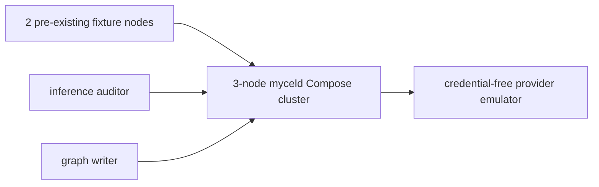

# compose-automation-reconciliation-recovery

## Purpose

Exercise durable graph automation reconciliation over pre-existing graph targets
through restart and repeated idempotent start calls.

## What this test proves

- Existing graph targets can be reconciled without synthetic graph updates.
- Reconciliation state and idempotency survive a retained-data rolling restart.
- The same idempotency key returns the original operation after restart and after completion.
- Scheduled targets use the normal procedure-inference path exactly once.
- Progress remains bounded and sanitized.

## Topology

The daemon runs with one reconciliation worker and one-item discovery batches so
checkpoint advancement and replay behavior remain bounded and observable.

## Scenario phases

1. Create two graph targets before the automation binding exists.
2. Provision the deterministic procedure-inference resources and a binding with bounded reconciliation discovery.
3. Start reconciliation with a stable idempotency key.
4. Restart the cluster and wait for authenticated, zero-lag recovery.
5. Re-submit the same operation, prove the original operation identity, and await two successful targets.
6. Restart again and prove the completed operation does not invoke the provider again.

## Actors

| Actor group | Profile | Count | Role |
| --- | --- | ---: | --- |
| `graph-writers` | `procedure-inference-writer` | 1 | Creates the pre-existing graph targets. |
| `inference-auditors` | `procedure-inference-auditor` | 1 | Owns the authenticated reconciliation and evidence reads. |

## Tunable parameters

| Parameter | Current value | Why tune it |
| --- | --- | --- |
| `seed` | `3112026` | Keeps fixture identities deterministic. |
| `batchSize` | `1` | Forces bounded page/checkpoint advancement. |
| `maxConcurrency` | `1` | Makes duplicate scheduling visible. |
| `MYCELD_AUTOMATION_WORKER_INTERVAL` | `2s` | Bounds resumption latency after restart. |

## Evidence and artifacts

Artifacts retain the resolved scenario, sanitized event records, actor acknowledgements,
cluster recovery observations, reconciliation progress counters, and provider-emulator
request totals. They do not retain graph payloads, prompts, credentials, or provider
request bodies.

## Common failure modes

- The binding is configured before the fixture nodes are created, so reconciliation has no targets.
- The operation ID changes when the same idempotency key is submitted after restart.
- Discovery schedules more than one invocation per target after replay.
- The provider emulator observes more than two requests.
- Cluster recovery reports a listener but not stable authenticated Raft progress.

## When to run

Run the dry-run during normal Lab validation. Run the destructive Compose scenario
against a locally built immutable daemon image before merging #311 or promoting a
release candidate.

## Related

- MycelDB/mycel#311
- `tests/reliability/scenarios/compose-procedure-inference-control-emulator`
