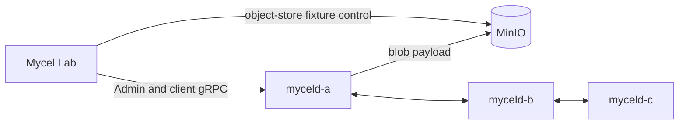

# compose-blob-snapshot-recovery

## Purpose

Reproduce MycelDB/mycel#312 with a deterministic, credential-free Compose cluster and an isolated MinIO object store. The scenario creates a Mycel-managed blob, captures a retained Raft snapshot, deletes the disposable space and its object-store payload, restarts one daemon from its retained volume, records the readiness blocker, restores the exact Mycel object-store payload, and proves that the daemon can recover.

This is a focused reliability scenario for the daemon fix. It verifies that missing object-store payloads are degraded as invalid local blob state and do not block retained-snapshot replay or node readiness.

## What this test proves

- The Compose fixture uses the object-store blob backend and an isolated MinIO bucket.
- The blob payload is captured through Mycel and the exact object-store key is discovered without retaining raw payload bytes.
- A retained Raft snapshot is created before destructive object-store manipulation.
- The restarted daemon remains ready when the payload is unavailable; the missing payload is recorded as invalid and can be removed by the replayed metadata deletion.
- Restoring the valid Mycel-encoded object to its original key preserves the repair path and confirms subsequent restart readiness.
- The final cluster converges and cleanup remains owned by the Lab runner.

The scenario deliberately preserves the encoded object before deletion. Restoring the raw fixture text instead would not prove a valid Mycel object-store repair.

## Topology

The scenario uses a three-daemon Compose cluster with retained daemon volumes and an isolated MinIO object store. The reliability runner controls the cluster and records bounded readiness, snapshot, and object-store metadata without persisting raw payloads.



## Scenario phases

1. **create-blob-fixture** — creates one disposable graph/blob fixture through the provisioned actor.
2. **capture-retained-snapshot** — compacts local Raft snapshots on ordinal 0.
3. **remove-payload-restart-and-repair** — backs up the encoded MinIO object, deletes the space and object, restarts ordinal 0, requires readiness despite the missing payload, restores the encoded object, restarts again, and requires readiness.
4. **final-cluster-recovery** — verifies stable cluster readiness after repair.

## Actors

The blob snapshot recovery actor creates and deletes the disposable space, captures snapshot state, manipulates the isolated object-store fixture, restarts the target daemon, and verifies readiness and final cluster convergence.

## Tunable parameters

The scenario uses bounded readiness and recovery deadlines, a fixed disposable fixture, an isolated Compose port allocation, and an exact daemon image supplied at run time. Adjust these only with corresponding scenario, evidence, and cleanup review.

## Scope and limitations

- Uses local MinIO as an S3-compatible backend; AWS S3-specific behavior still requires separate confirmation.
- The scenario covers the observed missing-payload path and the post-fix readiness contract. Set `expectedInitialReady: false` with `expectedBlocker: blob snapshot payload unavailable` to reproduce the pre-fix behavior.
- A follow-up variant should omit manual object deletion to isolate whether normal API space deletion alone leaves an unsafe retained-snapshot reference.
- The daemon marks the missing payload invalid locally while retaining Raft metadata authority; replayed deletion removes the stale reference.
- The destructive run requires fresh approval and `--confirm-destructive`.

## Evidence and artifacts

- `events.jsonl` records fixture, snapshot, object-store, readiness, and repair phases.
- The `blobSnapshotRecovery` result records only bounded IDs, object key metadata, readiness dimensions, and sanitized blockers.
- Raw object payloads, credentials, and MinIO command output are not persisted as scenario results.
- `result.json`, `summary.md`, and final cleanup/absence evidence are required before treating a run as valid.

## Common failure modes

- The selected daemon image is not the intended immutable candidate.
- The object-store payload is missing, malformed, or restored under the wrong key.
- The daemon does not become ready after the missing payload is deleted, or fails to recover after the exact object is restored.
- Snapshot, readiness, redaction, or post-run cleanup evidence is incomplete.

## When to run

```text
mycel-lab run scenario compose-blob-snapshot-recovery --dry-run
```

Real execution is destructive and requires fresh approval:

```text
mycel-lab run scenario compose-blob-snapshot-recovery \
  --confirm-destructive \
  --image myceldb/mycel:<exact-candidate>
```

## Related issue

- [MycelDB/mycel#312](https://github.com/MycelDB/mycel/issues/312)
- [MycelDB/mycel-lab#105](https://github.com/MycelDB/mycel-lab/issues/105)
