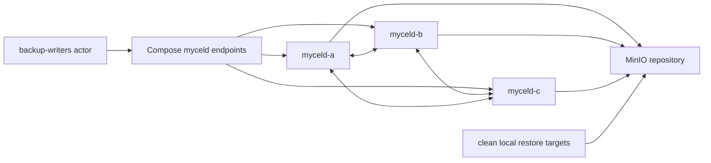

# compose-cluster-repository-backup

## Purpose

Validates repository-backed cluster backup and restore-start behavior in the Compose environment using the hermetic MinIO object-store fixture. The scenario exercises the S3-compatible repository contract, repository-truth list/get/validate behavior, denied-repository validation, negative repository fixtures, and daemon-side `NEW_CLUSTER_BOOTSTRAP` restore execution into clean local target directories.

## What this test proves

- A Compose raft cluster can register a MinIO-backed cluster backup repository using credential references rather than raw stored credentials.
- A quiesced `FILESYSTEM_IMMUTABLE_COPY` cluster backup uploads node archives, node manifests, inventories, `backup-set.json`, and `COMPLETE` to the repository.
- Repository-truth APIs list and validate only completed backup sets with valid manifests and complete markers.
- A repository configured with missing dev-only credential env refs is rejected and backup creation against it fails as expected without exposing raw credentials.
- Negative fixtures such as missing/corrupt `COMPLETE`, corrupt `backup-set.json`, interrupted publish, and partial node upload are rejected and not listed as restorable.
- `NEW_CLUSTER_BOOTSTRAP` / `PRESERVE_BACKUP_ID` restore can stage, decrypt when needed, apply, and verify each node archive into clean target data directories.

## Topology

## Scenario phases

1. **create-source-fixture**. Writes a deterministic graph fixture that must be present in the backup.
2. **configure-minio-repository**. Creates a repository config pointing at the Compose MinIO fixture.
3. **assert-repository-permission-failure-chaos**. Registers a second dev-only repository that references missing credential env vars, expects repository validation to fail, and proves backup creation against that repository fails without failing the scenario.
4. **capture-repository-backup**. Starts and waits for a repository-backed cluster backup.
5. **assert-repository-truth**. Lists, gets, validates, and negatively probes repository backup-set discovery.
6. **start-clean-target-restore**. Starts a clean-target `NEW_CLUSTER_BOOTSTRAP` restore and waits for verification.
7. **cleanup-repository-backup**. Deletes repository artifacts created by the scenario.

## Actors

| Actor group | Profile | Count | Role in this scenario |
|---|---|---:|---|
| `backup-writers` | graph writer fixture profile | `1` | creates deterministic source data before backup |

## Tunable parameters

| Parameter | Current value/source | Why tune it |
|---|---|---|
| `environment.driver` | `compose` | Selects the local Docker Compose runtime. |
| `objectStoreFixture` | `minio` | Enables the hermetic S3-compatible repository fixture. |
| `repositoryId` | scenario target | Change only when testing catalog isolation. |
| `prefix` | `mycel-lab/{runID}` | Keeps repository objects isolated per run. |
| `archiveFormat` | `tar` | Exercises the configured backup archive format. |
| `captureProvider` | `filesystem_immutable_copy` | Exercises the portable production capture path. |
| `targetRoot` / `stagingRoot` | scenario target | Use isolated paths for local restore-start validation. |

## Evidence and artifacts

- `events.jsonl` records repository creation, expected denied-repository validation/backup failure, backup creation, validation, restore start, and cleanup payloads.
- `result.json` and `summary.md` show phase status and final outcome.
- Repository evidence includes backup-set ID, repository prefix, manifest URI, node artifact URIs, checksums, and negative validation results.
- Compose evidence under `environment/` captures resolved endpoints, container state, logs, and cleanup.

## Common failure modes

- MinIO fixture startup or bucket initialization failure prevents repository creation.
- Invalid credential references, TLS settings, or repository encryption policy fail repository validation.
- Missing or corrupt `COMPLETE` / `backup-set.json`, interrupted-publish, and partial-upload fixtures must be rejected; if they list as restorable, repository-truth validation regressed.
- Restore failures usually indicate archive staging/decryption/extraction issues, dirty target directories, or manifest/checksum mismatches.
- Cleanup failures leave repository objects in the MinIO fixture and should be investigated before rerunning with the same prefix.

## When to run

Run when changing repository-backed backup creation, repository catalog/list/get/validate paths, S3-compatible repository handling, restore-start execution, archive encryption/decryption, or release-gate bundle behavior.

## Related files

- YAML: [`compose-cluster-repository-backup.yaml`](./compose-cluster-repository-backup.yaml)
- Suite: [`../../suites/compose-cluster-repository-backup.yaml`](../../suites/compose-cluster-repository-backup.yaml)
- Release gate: [`../../suites/cluster-release-gate.yaml`](../../suites/cluster-release-gate.yaml)
