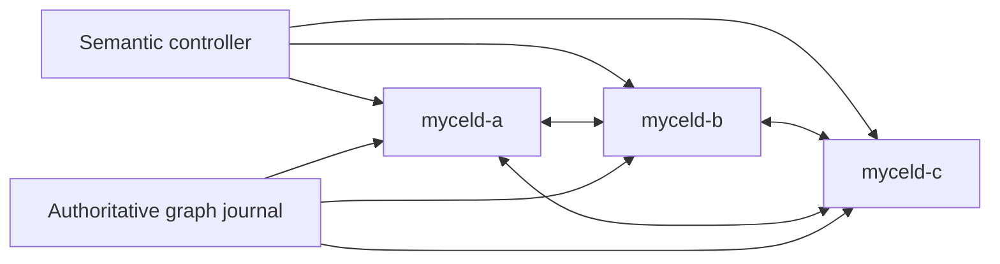

# compose-graph-change-handoff-loss

## Purpose

Reproduce loss of the node-local graph-change notification handoff after a graph mutation commits, while the authoritative graph journal and graph truth remain durable.

## What this test proves

- A three-node Compose cluster accepts a graph mutation while node-local notification storage is unavailable.
- Restart replays the authoritative graph-change journal and restores the durable semantic dirty event.
- Bounded analysis exposes pending semantic work for the committed revision while background maintenance remains disabled.
- Cleanup and redaction evidence are collected after the destructive run.

## Topology

Three Mycel services (`myceld-a`, `myceld-b`, and `myceld-c`) form a 16-partition Raft cluster. The scenario faults the notification path on all three nodes, but leaves graph Raft data and semantic metadata intact.

## Scenario phases

1. **establish-ready-semantic-baseline**. Creates and indexes a baseline document.
2. **make-notification-handoff-unwritable**. Moves the node-local notification directory aside and replaces it with an empty path on all nodes.
3. **commit-without-durable-derived-handoff**. Commits a document update and captures its graph revision.
4. **restore-notification-path**. Restores the original notification directory.
5. **restart-and-expose-missing-derived-work**. Performs a rolling restart, waits for cluster recovery, replays the authoritative journal, and asserts pending work.

## Actors

| Actor group | Profile | Count | Role |
|---|---|---:|---|
| `semantic-controller` | `semantic-controller` | `3` | creates the baseline, commits the faulted update, and verifies durable semantic work |

## Tunable parameters

| Parameter | Current value | Why tune it |
|---|---|---|
| `seed` | `4636` | Change only for an intentional alternate schedule. |
| `partitionCount` | `16` | Must match the Compose cluster topology. |
| `ordinals` | `[0, 1, 2]` | Selects all nodes whose notification paths are faulted and restored. |
| `background maintenance` | disabled | Keeps pending work available for the assertion boundary. |

## Evidence and artifacts

- `result.json` records phase outcomes.
- `events.jsonl` records fault, commit, restore, restart, and assertion events.
- `environment/` contains Compose configuration, service logs, and cleanup evidence.
- `oracle/` contains cluster-health and final reports.
- `redaction-scan.json` records redaction validation.

## Common failure modes

- Port collisions or stale Compose projects prevent environment creation.
- A graph commit failure while the notification path is faulted indicates an atomicity or handoff regression.
- Missing pending work after restart indicates journal replay, semantic dirty-event, or revision-fence failure.
- Cleanup or redaction failures require preserving the run artifacts for investigation.

## When to run

Run when changing graph commit handoff durability, authoritative journal replay, semantic dirty-event recovery, or clustered restart behavior.

## Safety

Use an isolated Compose project, isolated host ports, a digest-pinned Mycel image, and explicit destructive confirmation. The fault mutates only `/data/mycel/graph-change-notification`; normal cleanup must remove the Compose project and collected artifacts must pass redaction checks.

## Related files

- YAML: [`compose-graph-change-handoff-loss.yaml`](./compose-graph-change-handoff-loss.yaml)
- Suite: [`compose-graph-change-handoff-loss.yaml`](../../suites/compose-graph-change-handoff-loss.yaml)
