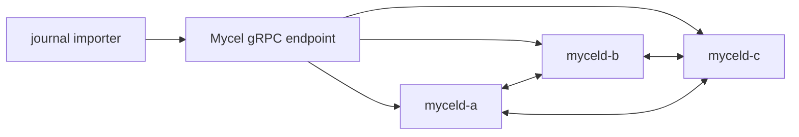

# compose-issue313-journal-import

## Purpose

Run an import-only, credential-free Compose reproduction of MycelDB/mycel#313 using the Commonfolio journal/page graph shape and one atomic transaction per import.

## What this test proves

- The importer-shaped workload reaches the daemon through `BeginReadWriteTransaction`, chunked `ApplyGraphOperations`, and one `CommitTransaction`.
- Chunking does not create intermediate commits or silently split one logical import.
- Bounded transaction counts, request protobuf size, latency, and redacted timing evidence are captured.
- The resulting graph shape and zero-partial-commit accounting remain observable.

## Topology

There is one importer actor and no concurrent reader or writer actors.

## Scenario phases

1. **bootstrap** — provisions the actor assignment and deterministic existing page targets.
2. **import-stress** — performs one atomic journal import per actor interval using bounded apply chunks.
3. **settle** — records final transaction accounting, graph counts, cluster health, cleanup, and redaction evidence.

## Actors

| Actor group | Profile | Count | Role |
|---|---|---:|---|
| `journal-importers` | `issue313-journal-import` | 1 | imports journals, entries, and page references through one atomic transaction |

## Tunable parameters

Edit `tests/reliability/actor-profiles/issue313-journal-import.yaml` for controlled comparisons:

- `entryPayloadBytes` and `journalPayloadBytes` — deterministic journal content size; the default 6 KiB entry payload produces a roughly 1.7 MiB operation request;
- `linksPerEntry` — reference fan-out;
- `pageTargetMode` — `existing-reused`, `existing-unique`, `same-transaction`, or `mixed`;
- `existingPageCount` and `sameTransactionPageCount` — target populations;
- `indexedProperties` — include or omit indexed journal/page properties;
- `applyChunkOperations` — request chunking inside the same atomic transaction;
- actor `commitsPerSecond` and the `import-stress` duration — number of importer transactions.

The scenario deliberately does not use the importer’s client-side committed-chunk fallback. Splitting one logical import into multiple commits would not qualify the atomic large-transaction path under investigation.

## Evidence and artifacts

- Actor events record bounded operation counts, request size, latency, target mode, and failed/unresolved/partial-commit accounting.
- `result.json`, `summary.md`, and oracle reports record phase and final assertion outcomes.
- Daemon graph-write traces provide bounded Raft, apply, storage, and sink timing fields.
- Cleanup and redaction artifacts establish disposable-environment cleanup and absence of credentials or raw payloads.

## Common failure modes

- The large import exceeds a transaction operation, byte, or deadline limit.
- HTTP/importer or gRPC deadlines expire while the daemon remains process/TCP healthy.
- Raft proposal/apply, storage lock, sync, or change-sink time dominates the commit.
- The transaction returns an error after partial state becomes visible.
- The selected image is mutable, has incorrect provenance, or differs between services.
- Cleanup or redaction evidence is incomplete.

## When to run

Run against the exact immutable baseline and candidate daemon images, one importer at a time, without concurrent readers or writers. Treat destructive Compose runs as requiring fresh approval, exact image provenance, and verified cleanup.

## Related issue

- [MycelDB/mycel#313](https://github.com/MycelDB/mycel/issues/313)
