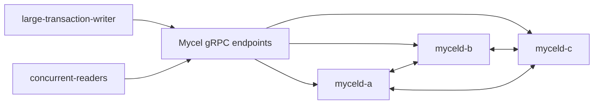

# compose-issue313-large-transaction

## Purpose

Run a credential-free Compose reproduction of MycelDB/mycel#313. One actor repeatedly commits deterministic 1024-node atomic graph transactions with approximately 768 bytes of node payload per node while three reader actors issue concurrent graph-backed queries and session traffic.

This scenario is baseline evidence only. It does not impose a production limit or claim that every failed transaction is a daemon defect.

## What this test proves

- The selected immutable daemon image can accept or reject a deterministic large atomic graph transaction through the real Compose API path.
- Transaction latency, operation count, and actor error classes are recorded without persisting raw graph payloads.
- Concurrent graph reads continue to be attempted while large commits are in flight.
- Compose service logs capture bounded graph-write timing fields, including Raft command size and storage/apply timings.
- Final cluster identity, health, cleanup, and acknowledged-transaction accounting remain observable.

## Topology



## Scenario phases

1. **bootstrap** — provisions the actor assignment and allows the cluster/readers to settle.
2. **large-transaction-stress** — commits repeated 1024-node transactions while readers issue concurrent graph-backed requests.
3. **settle** — allows final convergence and records cluster health without requiring all large transactions to succeed.

## Actors

| Actor group | Profile | Count | Rate | Role |
|---|---|---:|---:|---|
| `large-transaction-writers` | `issue313-large-transaction-committer` | 1 | 0.1 commits/s | commits exactly 1024 deterministic node creates per transaction |
| `concurrent-readers` | `gql-reader` | 3 | 4 queries/s total | issues graph-backed read/session requests against the writer assignment |

## Tunable parameters

- `operationsPerTransaction`: fixed at 1024 to target the reported large atomic transaction path.
- `nodePayloadBytes`: fixed at 768; the resulting encoded Raft command is expected to be near 1 MiB but must be measured from daemon trace evidence.
- `commitsPerSecond`: low enough to isolate one large commit at a time; increase only for queue/backpressure experiments.
- `queriesPerSecond`: concurrent read pressure; keep bounded so failures remain attributable.
- `MYCELD_GRAPH_WRITE_TRACE`: enabled through the scenario cluster override.
- `environment.grpcPorts`: isolated to `19315–19317`.
- `--image`: must be an exact immutable daemon image reference; tags alone are not accepted as provenance.

## Evidence and artifacts

- `events.jsonl` records acknowledged/failed transactions, commit latency, error class, and read checks.
- `result.json` and `summary.md` record phase and final assertion outcomes.
- Compose logs contain bounded `graph_write_commit_timing`, `graph_write_apply_timing`, and `raft_command_bytes` fields; raw graph payloads are not written to actor events.
- `environment/compose-config.yaml`, `environment/compose-ps.txt`, and cleanup evidence establish the exact disposable environment.
- Image provenance must identify the immutable digest used by all three daemon services.

## Common failure modes

- The large transaction exceeds a transport, session, or execution deadline.
- The transaction returns 503/504 while concurrent reads remain process/TCP healthy.
- Raft proposal/apply latency, storage lock wait, sync time, or change-sink time dominates the commit.
- Reader/session traffic returns 503/504 or becomes unavailable during large commits.
- The selected image is mutable, the wrong architecture, or differs between services.
- Compose cleanup or redaction evidence is incomplete.

## When to run

Run first against the exact v0.21.2 immutable candidate associated with the report, then against a current candidate built from the investigation branch. Treat both runs as destructive environment tests requiring fresh approval, exact image provenance, and verified cleanup.

```sh
go run ./cmd/mycel-lab run scenario compose-issue313-large-transaction \
  --confirm-destructive \
  --image docker.io/myceldb/mycel@sha256:<exact-platform-digest>
```

## Related issue

- [MycelDB/mycel#313](https://github.com/MycelDB/mycel/issues/313)
