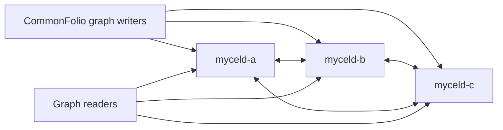

# compose-lexical-replay-frontier

## Purpose

Exercises historical lexical replay after local lexical artifacts are removed while graph history and replicated projection metadata remain intact.

## What this test proves

- A three-node Compose cluster survives local lexical artifact loss and rolling restart.
- Historical graph changes can be replayed to rebuild local lexical state.
- The daemon does not emit bounded frontier-regression or strong-read failure diagnostics during recovery.

## Topology

Three Mycel services (`myceld-a`, `myceld-b`, and `myceld-c`) form a 16-partition Raft cluster. Graph actors write through all three endpoints while readers verify graph convergence.

## Scenario phases

1. **seed-retained-graph-history**. Writes CommonFolio-shaped graph history.
2. **remove-local-lexical-artifacts**. Removes only `/data/mycel/search/lexical` on all nodes.
3. **restart-for-historical-replay**. Performs a rolling restart with retained graph and projection metadata.
4. **wait-for-replay-recovery**. Waits for all 17 Raft groups to recover.
5. **post-replay-validation**. Verifies workload progress and converged graph counts.
6. **collect-frontier-diagnostics**. Scans Compose service logs for frontier-regression and strong-read failure patterns.

## Actors

| Actor group | Profile | Count | Role |
|---|---|---:|---|
| `graph-writers` | `commonfolio-graph-committer` | `3` | writes CommonFolio-shaped graph transactions |
| `readers` | `gql-reader` | `3` | validates graph reads and convergence |

## Tunable parameters

| Parameter | Current value | Why tune it |
|---|---|---|
| `seed` | `22330222` | Change only for an intentional alternate schedule. |
| `commitsPerSecond` | `24` during seeding | Increase timing pressure or reduce for debugging. |
| `partitionCount` | `16` | Must match the Compose cluster topology. |
| `ordinals` | `[0, 1, 2]` | Selects nodes whose local lexical artifacts are removed. |

## Evidence and artifacts

- `result.json` records phase outcomes.
- `events.jsonl` records artifact-loss and restart events.
- `environment/` contains Compose configuration, service logs, and cleanup evidence.
- `oracle/` contains graph consistency and cluster-health reports.

## Common failure modes

- Port collisions or stale Compose projects prevent environment creation.
- Artifact-loss execution failures indicate node-exec or container filesystem problems.
- Recovery failures should be debugged from service logs, `events.jsonl`, and `oracle/` artifacts.
- A log assertion failure indicates a replay/frontier diagnostic that needs investigation.

## When to run

Run when changing lexical replay ordering, projection frontier publication, clustered restart recovery, or the Compose qualification harness.

## Related files

- YAML: [`compose-lexical-replay-frontier.yaml`](./compose-lexical-replay-frontier.yaml)
- Suite: [`compose-lexical-replay-frontier.yaml`](../../suites/compose-lexical-replay-frontier.yaml)
