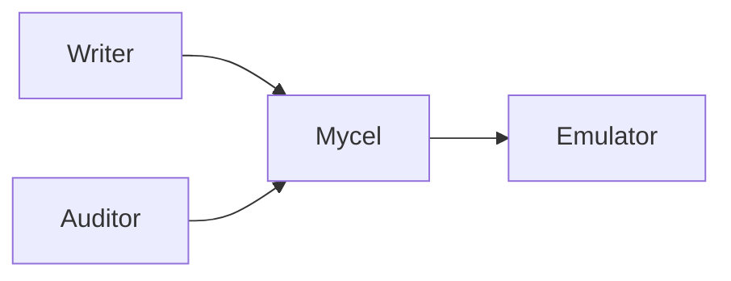

# compose-procedure-inference-control-emulator

## Purpose

Credential-free acceptance for daemon-owned procedure-inference evidence and control.

## What this test proves

- successful requested-to-terminal lifecycle with exact procedure/binding versions;
- immutable event IDs and increasing per-space change sequences;
- snapshot cursor to change-feed continuity and typed run references;
- completed disable/enable barriers and no new provider attempt while disabled;
- sanitized diagnostics and emulator observations without prompts, graph content, outputs, credentials, provider bodies, or provider request IDs.

## Topology

A Compose daemon plus an internal OpenAI-compatible generation emulator. The emulator has no host port.



## Scenario phases

Provision inference/control resources, configure a procedure and binding, trigger and observe one attempt, disable and test exclusion, enable and trigger another attempt, then reconcile bounded diagnostics and emulator evidence.

## Actors

The graph writer is the isolated target-space owner and only commits graph data; it receives no automation or inference capabilities. A separate audit actor has `space.viewer` for target-space/domain visibility plus `automation.admin`, which supplies `automation.read`, `automation.manage`, and `inference.audit.read`. The writer never provisions inference authorization or receives inference-specific scopes.

## Tunable parameters

Provider requests, operations, concurrency, retries, tokens, timeout, poll pages, and attempt counts are finite in the scenario/provider profiles. Extreme 10,000-attempt and 64 MiB boundaries remain daemon unit/race coverage.

## Evidence and artifacts

The run records sanitized typed event results, emulator digests/categories, redaction results, exact daemon image digest, and harness revision. It never persists provider request bodies or generation output.

## Common failure modes

Missing generation capability, missing audit scope, failed control acknowledgements, a new attempt while disabled, unstable event IDs, cursor/history gaps, run-reference mismatches, unsafe diagnostics, or unexpected emulator calls fail closed.

## When to run

Run the dry-run during contract development. A real run is destructive and requires fresh approval and an exact candidate image:

```sh
mycel-lab run suite-file tests/reliability/suites/compose-procedure-inference-control-emulator.yaml --dry-run
mycel-lab run suite compose-procedure-inference-control-emulator --confirm-destructive --image myceldb/mycel:<exact-candidate>
```
