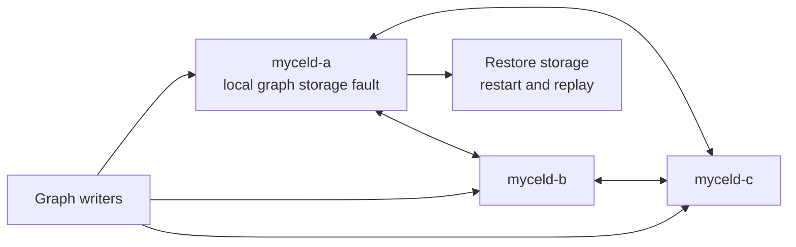

# compose-raft-apply-failure-recovery

## Purpose

Reproduce a committed graph mutation whose local Raft state-machine apply cannot reach graph storage, then verify that the failed node fences the group and replays the committed entry after recovery.

## What this test proves

- A three-node Compose cluster commits graph work while one node's graph storage is unavailable.
- The affected local Raft group reports an apply stop and does not advance past the failed application.
- Restoring storage and restarting the node replays the committed entry, clears apply lag, and converges graph state without acknowledged transaction loss.

## Topology

Three Mycel services (`myceld-a`, `myceld-b`, and `myceld-c`) form a 16-partition Raft cluster. Node ordinal `0` has its graph storage directory moved aside and replaced by a file; the directory is restored before the node restarts.

## Scenario phases

1. **establish-committed-graph-work**. Graph actors create committed transactions.
2. **inject-local-apply-storage-failure**. Makes `/data/mycel/graphs` unavailable on `myceld-a` while actors continue writing.
3. **assert-failed-apply-is-fenced**. Requires the daemon log to contain the apply-stop diagnostic.
4. **restore-and-replay**. Restores graph storage, restarts node `0`, allows the restarted endpoint to settle, and waits for zero apply lag and consistent cluster progress.

## Actors

| Actor group | Profile | Count | Role |
|---|---|---:|---|
| `graph-writers` | `graph-committer` | `2` | Generates committed graph transactions and records acknowledgements and convergence checks |

## Tunable parameters

| Parameter | Current value | Why tune it |
|---|---|---|
| `seed` | `340` | Change only for an intentional alternate schedule. |
| `partitionCount` | `16` | Must match the Compose cluster topology. |
| `ordinal` | `0` | Selects the node whose graph storage is faulted and restored. |
| graph-writer rate | `8 commits/second` | Increase only when extending the bounded fault window. |
| restart settle delay | `3s` | Keep recovery polling from racing the restarted Compose endpoint. |

## Evidence and artifacts

- `result.json` records phase outcomes.
- `events.jsonl` records storage fault, log assertion, restore, restart, and recovery events.
- `environment/` contains Compose configuration, service logs, and cleanup evidence.
- `oracle/` contains cluster-health and final convergence reports.
- `redaction-scan.json` records redaction validation.

## Common failure modes

- No apply-stop log indicates the failed state-machine application was not fenced.
- Apply lag or inconsistent progress after restart indicates replay or durable Raft recovery failure.
- Acknowledged transaction loss indicates a commit/replay correctness regression.
- Cleanup or redaction failures require preserving the run artifacts for investigation.

## When to run

Run when changing Raft apply outcomes, state-machine persistence, graph commit replay, or clustered recovery behavior.

## Safety

Use an isolated Compose project, isolated host ports, a digest-pinned Mycel image, and explicit destructive confirmation. The fault moves only `/data/mycel/graphs` to a backup path and restores it before restart; normal cleanup must remove the Compose project and collected artifacts must pass redaction checks.

## Related files

- YAML: [`compose-raft-apply-failure-recovery.yaml`](./compose-raft-apply-failure-recovery.yaml)
- Suite: [`compose-raft-apply-failure-recovery.yaml`](../../suites/compose-raft-apply-failure-recovery.yaml)
