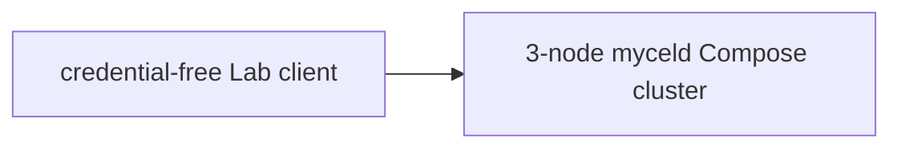

# compose-revision-fence

## Purpose

Exercise revision-fenced graph commits through the real Mycel gRPC endpoint.

## What this test proves

- Revision-fenced graph commits use the real Mycel gRPC endpoint.
- A write with a current witness succeeds.
- A stale derived write returns `ABORTED` with `GRAPH_REVISION_FENCE_CONFLICT`.
- The stale mutation leaves no partial graph state and the daemon remains usable.
- Witness bytes and graph payloads are not copied into Lab evidence.

## Topology

## Scenario phases

1. Read the target and capture an opaque revision witness.
2. Mutate an unrelated node and commit the target update with the witness.
3. Read the target again, mutate it, and submit a stale derived write.
4. Assert the typed conflict and post-rejection daemon health.

## Actors

The scenario uses a bounded Lab event client rather than a long-running actor.
All graph fixtures are deterministic and credential-free.

## Tunable parameters

| Parameter | Current value | Why tune it |
| --- | --- | --- |
| Scenario seed | deterministic fixture seed | Reproduce the same graph identities. |
| Compose ports | dedicated revision-fence ports | Avoid interference with sequential runs. |

## Evidence and artifacts

Artifacts contain only bounded status/reason booleans and witness-presence / size
indicators. Witness contents and graph payloads are redacted. The additive
protobuf fields are sent and received through the production wire contract.

## Common failure modes

- A stale witness is accepted instead of producing the typed conflict.
- The rejected write leaves partial graph state.
- The daemon is unhealthy after the rejection.
- Evidence includes witness contents or graph payloads.

## When to run

Run this scenario after revision-fence, transaction, or SDK wire-contract changes.
Use a sequential disposable Compose environment; no hosted provider is required.

## Related

- MycelDB graph revision-fence API contract
- `tests/reliability/suites/compose-revision-fence.yaml`
