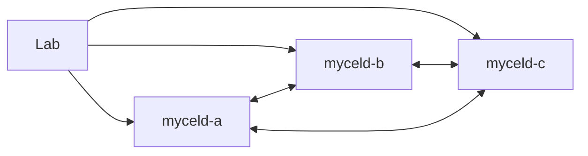

# compose-semantic-domain-isolation

Generated by `scripts/generateSemanticCompatibilityCases.py`. Edit its declared
fixtures and regenerate; generated definitions are not runtime qualification.

## Purpose

Prove domain-only isolation with the same authorized principal, the same space, the same node UUID in two distinct normal domains, and positive active indexes in both. Broad searches omit both rule and binding filters; exact configured provenance and hydrated payloads must match their own domain. A peer update and retained restart must preserve the independent primary record.

## What this test proves

Public graph commits, exact semantic scope/route/provenance, negative controls,
and record/generation persistence contribute directly to the run verdict. No
lexical/hybrid/scan fallback, warning, missing diagnostic, or repair reset passes.

## Topology

Three disposable Compose Raft daemons, retained data through rolling restart,
and the local deterministic fake/token-basis embedding connector. No provider
emulator, external credentials, or hosted provider is required. Background semantic
scheduling is disabled; ordinary public maintenance APIs remain available.



## Scenario phases

The adjacent YAML defines five finite phases, including positive baseline,
controlled compatibility/isolation transitions, and retained-restart persistence.
Only migration uses explicit authorized rebuilds, after proving rejection and
advanced generation. Isolation never repairs its indexes to mask leakage.

## Actors

Three endpoint-local semantic controllers provide normal authenticated clients.
A domain peer retains the same principal and space while changing only domain.
Alternate route resources remain owned and tracked for ordinary cleanup.

## Tunable parameters

Immutable v0.21.4 is pinned in manifest and Compose selection. Public operations
have 30-second bounds. Recovery requires three stable health polls within 60
seconds. Domain variants, model listings, and cleanup resource graphs are finite.
Image/fixture changes require fresh evidence and approval, not weakened assertions.

## Evidence and artifacts

Retain acknowledged per-domain graph revisions, exact scope identities, broad
search requests and semantic provenance, migration rejection/generation states,
selected configured IDs and vector shapes, record/configuration captures, endpoint
recovery, final oracle, mandatory cleanup/absence, and redaction verdicts. Payload
checks retain verdicts, not confidential graph content.

## Common failure modes

Changed principal/space masquerading as domain isolation, empty decoy indexes,
rule-filtered queries masquerading as broad isolation, wrong-domain hydration,
non-advancing generation, stale model/vector identity, accepted pre-rebuild search,
replayed post-restart records, and incomplete cleanup all fail closed. Failed
mutations are not automatically resubmitted.

## When to run

Planning only:

```sh
mycel-lab run scenario compose-semantic-domain-isolation --dry-run
```

A real run modifies disposable Compose resources and needs explicit fresh
operator approval of the exact clean source/image/artifact identities. Unit tests
and dry-runs are harness evidence, not daemon acceptance or run authorization.
