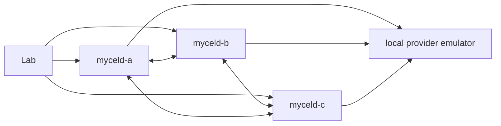

# compose-semantic-fault-deadline

Generated by `scripts/generateSemanticFaultMatrix.py`; edit the declarative matrix
there and regenerate. Definitions are not runtime qualification.

## Purpose

Inject `deadline`, prove the expected `deadline` state with no false freshness, then recover the same work with exactly two attempts.

## What this test proves

Requires public graph/work/freshness/search evidence, exact local protocol counts,
and no lexical, hybrid, scan, or hydration fallback. All declared assertions affect
the run verdict. Missing capabilities fail closed; no repair rebuild is allowed.

## Topology

Three disposable Compose Raft daemons and one local protocol emulator. Background
semantic scheduling is explicitly disabled so provider injection is controlled;
ordinary public Analyze/Process APIs remain enabled. Ports 19091–19093 are used
sequentially, with mandatory scenario cleanup.



## Scenario phases

See the adjacent generated YAML for the exact finite ordering. Provider outcomes
are a global request sequence with no implicit successful fallback after exhaustion.
Expected negative outcomes must be witnessed before any authorized recovery.

## Actors

Three endpoint-local semantic controllers; only the selected isolated controller
scope owns the one-document corpus. No hosted-provider identity or secret is used.

## Tunable parameters

The daemon is pinned to immutable v0.21.4. Public operation timeout is 30 seconds;
profile total budget is ten minutes. Gates, cancellation, listing, RPCs, and waits
are bounded. Supply a clean revision-labelled emulator built from this exact Lab
source, not the development default. Changing a fixture or image requires fresh
evidence; do not weaken assertions to obtain a pass.

## Evidence and artifacts

Retain acknowledged graph revisions, work IDs/generations/revision ranges/attempts,
frontiers and gaps, controlled completion order or failure disposition, direct
semantic record provenance, finite sanitized provider observations, final oracle,
cleanup/absence, and redaction verdicts. The emulator's per-input attempt counter
counts all requests with the same input (including direct search), not just work
retries. Assert the exact request distribution by safe input digest. Fault cases
separately prove the public same-work attempt count; the ordering case proves
supersession and retained newer record identity. Connection-drop status 503 is a synthetic
observation marker: the emulator closes the connection without an HTTP response.

## Common failure modes

Early gate release, stale overwrite, false freshness, dropped/changed work,
wrong failure classification, missing retry delay, excess attempts, invalid source
provenance, request-sequence exhaustion, fallback, and leaked evidence fail the run.
Cancellation/deadline cases require unresolved work and explicit authorized retry;
retryable cases must respect not-before and recover through normal maintenance.

## When to run

Credential-free planning only:

```sh
mycel-lab run scenario compose-semantic-fault-deadline --dry-run
```

Real execution modifies disposable Compose resources and requires explicit fresh
operator approval of the exact clean harness, daemon, emulator, and artifact root.
No definition, unit test, or dry-run authorizes it or proves daemon behavior.
