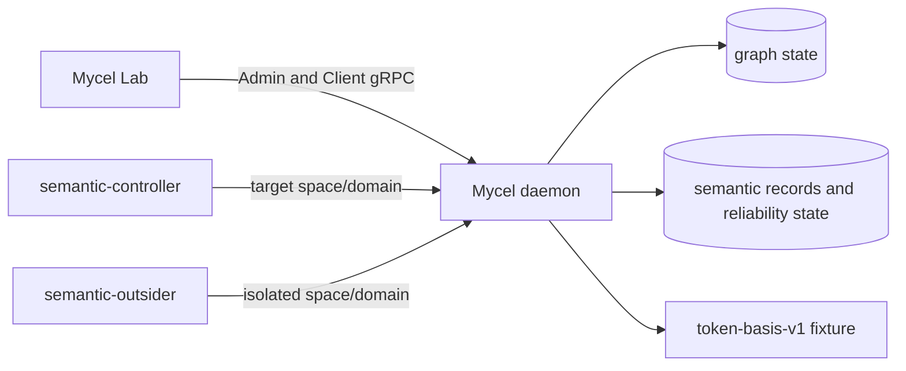

# Compose semantic graph-index contract

## Purpose

Provide the credential-free compose-first SGT3–SGT5 contract suite for Mycel Lab issue #46.

## What this test proves

The scenario proves:

- public-API semantic provisioning and bounded backfill;
- direct retrieval with deterministic order, scores, source-record identity, configured route provenance, pagination, and hard eligibility filtering;
- post-rule indexing, excluded-property stability, projected-property replacement, and deletion;
- rollback and failed-statement isolation;
- cross-space and authorization isolation;
- disabled-rule negative behavior and re-enable catch-up;
- distinct analyzed/fresh frontiers without unresolved gaps;
- incompatible projection generation rotation, stale-record rejection, pinned rebuild, and bounded delta catch-up.

## Topology

The suite uses the compose three-daemon Raft topology and two isolated semantic-controller actor groups. The default `deterministic-token-basis-v1` provider performs no network or credential access.



## Scenario phases

1. Seed graph fixtures before creating the rule.
2. Create the deferred rule, backfill, and reach the Level 2/3 barrier.
3. Prove ranking, pagination, provenance, and filtering.
4. Exercise post-rule create, excluded/projected update, transaction negatives, isolation, and deletion.
5. Disable and re-enable the rule.
6. Rotate projection generation, prove old records stale, create an eligible `Document` while the rebuild is running, then prove pinned baseline provenance plus the delta record's exact later revision, generation, and rebuild epoch.

## Actors

`semantic-controller` owns the target space/domain and performs graph and semantic control operations. `semantic-outsider` owns a distinct space/domain and supplies isolation and unauthorized-access negatives.

## Tunable parameters

The scenario fixes bounded 30-second maintenance deadlines, 100-millisecond polling, finite backfill/maintenance batches, explicit page sizes, and deterministic score tolerances. Change these only with corresponding contract and artifact review.

## Evidence and artifacts

Required events emit graph transaction/revision evidence, maintenance observations, reliability frontiers, direct semantic results, record IDs, safe provenance, filter diagnostics, rebuild state, and cleanup outcomes. Final artifacts must pass the redaction scan. Dry-run output is planning evidence only.

## Common failure modes

- Missing Admin semantic reliability capability.
- Required resource/grant/policy not provisioned.
- Maintenance timeout, degraded state, unresolved gap, or rebuild-required marker.
- Stale/mismatched page token, record identity, generation, or configuration.
- Unexpected warning, fallback, unauthorized disclosure, or redaction finding.

## When to run

Run dry-run on every scenario/schema change. Run the real environment-mutating compose suite before accepting SGT3–SGT5 or a compatible release, with explicit operator approval.

```sh
go run ./cmd/mycel-lab run scenario-file \
  tests/reliability/scenarios/compose-semantic-graph-contract/compose-semantic-graph-contract.yaml \
  --provider-profile tests/reliability/provider-profiles/deterministic-token-basis-v1.yaml \
  --image local/mycel:<exact-head> \
  --dry-run
```
