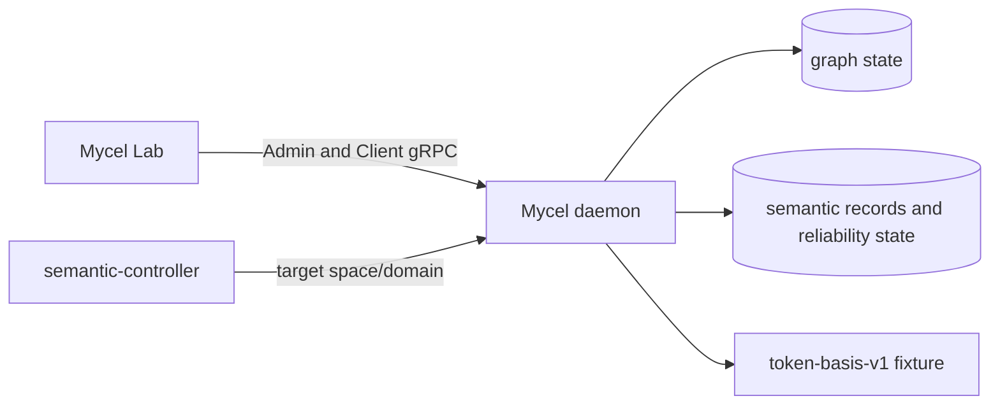

# Compose semantic graph-index recovery

## Purpose

Provide the credential-free compose-first Tranche B recovery suite for Mycel Lab issue #46. The scenario complements the semantic graph-index contract by proving deterministic semantic records remain valid through rolling restarts, post-restart indexing, rebuild from graph truth, and rebuild delta catch-up.

## What this test proves

The scenario proves:

- a converged deterministic semantic index remains usable after a rolling Compose restart;
- unchanged semantic content retains the same vector-record identity across restart;
- new graph data committed after restart is indexed and searchable;
- a projection change marks the rule as rebuild-required;
- rebuild from graph truth creates a new semantic generation/configuration;
- a graph mutation committed while rebuild is running is caught up by the rebuilt generation;
- rebuilt semantic records remain usable after another rolling restart.

This initial Tranche B scenario does not yet prove scripted stale/out-of-order provider responses or scripted provider retry/degraded-state behavior. Those require deterministic provider outcome scripts or emulator profiles and are tracked as later Tranche B/C work.

## Topology

The suite uses the Compose three-daemon Raft topology and a single semantic-controller actor group. The default `deterministic-token-basis-v1` provider performs no network or credential access.



## Scenario phases

1. Seed deterministic graph fixtures, create the deferred semantic rule, force backfill, reach convergence, and capture the baseline semantic record, generation, and configuration hash.
2. Perform a rolling Compose restart and prove the baseline record remains directly searchable with the same record identity and configuration.
3. Commit a new post-restart graph node and prove semantic maintenance catches it up.
4. Change the projection, require rebuild, rebuild from graph truth while committing a concurrent delta node, and prove both pinned baseline and delta records belong to the rebuilt generation/epoch.
5. Perform another rolling restart and prove rebuilt delta search remains valid.

## Actors

`semantic-controller` owns the target space/domain and performs graph mutations, semantic rule operations, maintenance waits, direct semantic searches, and rebuild assertions.

## Tunable parameters

The scenario fixes a 1-millisecond rule cooldown, bounded 30-second maintenance deadlines, 100-millisecond polling, finite backfill/rebuild batches, deterministic score tolerances, and full-cluster rolling restarts. Change these only with corresponding contract and artifact review.

## Evidence and artifacts

Required events emit graph transaction/revision evidence, rolling-restart evidence, maintenance observations, reliability frontiers, direct semantic search results, vector-record IDs, generation/configuration/rebuild provenance, and cleanup outcomes. Compose capture records daemon image evidence in `environment/compose-images.jsonl`. Final artifacts must pass the redaction scan. Dry-run output is planning evidence only.

## Common failure modes

- Missing Admin semantic reliability capability.
- Missing rolling-restart capability in the selected environment driver.
- Maintenance timeout, degraded state, unresolved gap, or rebuild-required marker after rebuild.
- Baseline record identity changes across restart without a graph/projection change.
- Rebuild does not advance generation/configuration or fails to catch up the concurrent delta.
- Unexpected warning, fallback, stale record, or redaction finding.

## When to run

Run dry-run on every scenario/schema change. Run the real environment-mutating Compose suite before accepting Tranche B recovery coverage or before release qualification that depends on semantic index restart/rebuild behavior, with explicit operator approval.

```sh
go run ./cmd/mycel-lab run suite semantic-graph-index-recovery --dry-run

go run ./cmd/mycel-lab run suite semantic-graph-index-recovery \
  --confirm-destructive \
  --image local/mycel:<exact-head>
```
