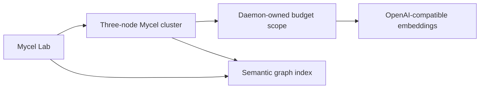

# Compose semantic live provider (SGT9)

## Purpose

Validate direct OpenAI-compatible embeddings with daemon-owned provider budgets and invariant-based semantic ranking.

## What this test proves

- Authenticated daemon capability discovery succeeds before credential resolution.
- The semantic rule owns an active, immutable provider-budget scope whose limits and pinned endpoint/model/capability route exactly match the requested policy.
- Provider effects are reserved and reconciled through bounded append-only attempt events, including request/retry identity and per-request/batch constraints.
- A fixed synthetic corpus satisfies create, update, and delete ranking invariants without asserting exact vectors or scores.
- An ungranted actor cannot use semantic search or the live credential route.

## Topology

A three-node Compose Raft cluster uses one semantic controller space and the `openai-compatible-live` provider profile.

## Scenario phases

1. Seed three synthetic documents before rule creation.
2. Create the rule, backfill all documents, and await semantic convergence.
3. Assert the relevant document ranks first and reject an ungranted actor.
4. Update the relevant document, prove it still ranks first for the updated query, then delete it and prove absence.
5. Reconcile exact requested limits, the pinned route, aggregate usage, and immutable attempt events.

## Actors

`semantic-controller` owns the isolated space and executes finite event-driven mutations; it has no background workload loop. `semantic-outsider` is deliberately excluded from the credential grant and provides the authorization negative control.

## Tunable parameters

The provider profile controls request, retry, concurrency, batching, token, timeout, and versioned USD cost ceilings. The scenario controls maintenance limits and convergence polling.

## Evidence and artifacts

Evidence records authenticated capability names, the approved configured endpoint/model route, aggregate budget usage, immutable event counts, pairing validity, and bounded invariant outcomes. It omits credentials, source text, queries, vectors, provider-generated request or attempt identifiers, provider bodies, raw provider errors, and raw daemon logs. Live runs require immutable harness and daemon-image provenance before provider setup.

## Common failure modes

- Missing explicit destructive approval.
- Missing `OPENAI_API_KEY` after capability discovery.
- Daemon capability discovery reports any required enforcement invariant as unavailable.
- The configured endpoint is not the explicitly approved `https://api.openai.com/v1` route, or outbound network policy blocks it.
- Ranking or immutable-event reconciliation fails.

## When to run

Run only after API, SDK, daemon, and Lab candidates are reviewed, with an approved daemon image, approved network/model/corpus/budget, explicit destructive approval, and an operator-provided `OPENAI_API_KEY`. The dry-run path performs no credential lookup and no provider call.
