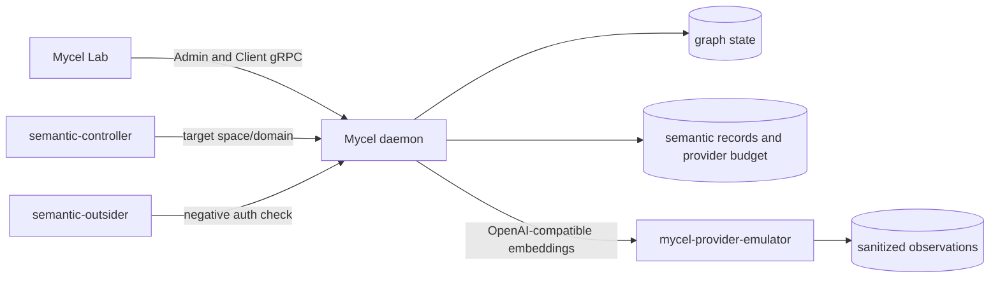

# Compose semantic OpenAI-compatible emulator

## Purpose

Provide the credential-free Tranche C protocol-emulator suite for Mycel Lab issue #46. The scenario complements deterministic contract and recovery coverage by proving semantic graph indexing can use a local OpenAI-compatible embedding protocol without live provider credentials.

## What this test proves

The scenario proves:

- the local `mycel-provider-emulator` can back an OpenAI-compatible `/v1/embeddings` semantic profile;
- semantic rule provisioning, backfill, maintenance, search, and update lifecycle work through the emulator-backed route;
- provider budget reservation and terminal attempt evidence can be reconciled for emulator-backed semantic work;
- unauthorized semantic search remains denied while preserving budget evidence expectations; and
- sanitized provider-emulator observations record bounded protocol metadata such as model name, request count, batch size, status, outcome, response model, request IDs, and maximum attempts per input.

This initial Tranche C scenario covers the successful OpenAI-compatible embedding path. Scripted retry, timeout, malformed response, invalid-dimension, refusal, and no-fallback cases remain follow-on protocol-emulator work.

## Topology

The suite uses the Compose three-daemon Raft topology plus the generated provider-emulator service. The semantic embedding profile points daemon containers at `http://mycel-provider-emulator:18080/v1` and does not require secrets.



## Scenario phases

1. Seed three synthetic `Document` nodes with bounded fixture text.
2. Create the deferred semantic rule, force one-item backfill batches, await convergence, assert reliability, and check initial emulator observations.
3. Execute semantic search, verify unauthorized search behavior, reconcile provider budget events, and re-check emulator observations.
4. Update one indexed document, await convergence, prove the updated record is searchable, reconcile provider budget events again, and assert final emulator protocol observations.

## Actors

- `semantic-controller` owns the target space/domain and performs graph mutations, semantic rule operations, maintenance waits, searches, and assertions.
- `semantic-outsider` targets the controller actor group only for negative authorization coverage.

## Tunable parameters

The scenario fixes one-item semantic batches, one worker, a 1-millisecond dirty cooldown, 45-second maintenance deadlines, 150-millisecond polling, bounded emulator request counts, and finite provider budget expectations. Change these only with corresponding updates to emulator and budget assertions.

## Evidence and artifacts

Artifacts include the resolved non-secret scenario/profile, daemon image evidence, provider-emulator image evidence, sanitized emulator observations under `provider/emulator-observations.jsonl`, provider budget reconciliation summaries, semantic search/reliability assertion payloads, actor events, and final redaction-scan results. Emulator profile artifacts disable request/response body and header capture.

## Common failure modes

- Provider emulator image is missing or cannot be started.
- The semantic profile does not include a protocol emulator script.
- Daemon containers cannot reach `mycel-provider-emulator:18080`.
- Backfill or update maintenance times out or leaves unresolved gaps.
- Provider budget history is incomplete or lacks terminal events.
- Emulator observations show unexpected model, status, outcome, batch size, retry count, or request count.
- Artifact redaction detects captured provider headers, bodies, or secret-like values.

## When to run

Run dry-run on every scenario/schema change. Run the real environment-mutating Compose suite before accepting Tranche C protocol-emulator coverage or before release qualification that depends on credential-free provider protocol compatibility, with explicit operator approval.

```sh
go run ./cmd/mycel-lab run suite semantic-graph-index-protocol --dry-run

go run ./cmd/mycel-lab run suite semantic-graph-index-protocol \
  --confirm-destructive \
  --image local/mycel:<exact-head>
```
