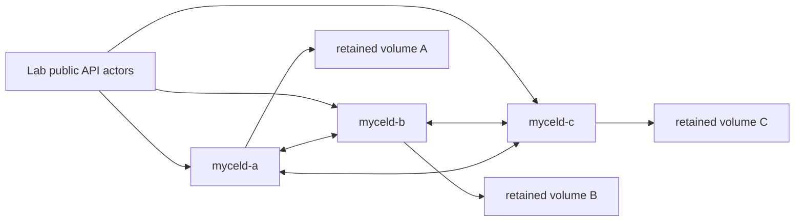

# Compose semantic pending-work restart

## Purpose

Exercise controlled pending semantic work across retained-data restart on the
released v0.21.4 baseline, without repair or reconstruction masking a failure.

## What this test proves

Target daemon: **v0.21.4**, immutable index:

```text
docker.io/myceldb/mycel@sha256:0973cddd9c282abff40d8edeb2e8f7a801e58d40bfbab4c8507ce2d9daae2dd7
```

This credential-free scenario proves retained pending-work identity before
explicitly resuming normal maintenance. It uses only public graph, semantic,
maintenance, reliability, and search APIs. The selected daemon must expose
positive work generation and first/last graph revision fields; missing or
contradictory evidence fails the run rather than downgrading the proof.

## Topology

Three Compose-backed Raft daemons retain their existing data volumes through two
rolling restarts. The scenario explicitly declares 16 Raft partitions to match
the three-node Compose fixture; the generic cluster profile otherwise defaults
to 64. The suite preflight rejects a mismatch before provisioning any scenario.
It uses ports 19091–19093; run it sequentially with other scenarios using those ports.
The initial corpus has one eligible synthetic Document in the controller scope.



## Actors

Three endpoint-local `semantic-controller` assignments provide authenticated
public clients. One selected controller owns the semantic corpus; the others
provide correctly issued endpoint-local readiness sessions. No hosted-provider
credentials or provider emulator are needed by the deterministic profile.

## Scenario phases

The dedicated Compose overlay sets
`MYCELD_SEMANTIC_MAINTENANCE_ENABLED=false` on all three daemons. This disables
background scheduling, not the public Analyze/Process APIs or readiness fences.
It makes the pre-restart pending boundary deterministic without sleeps or races
against a worker timer. Each checkpoint verifies this configuration through the
public maintenance status response.

The scenario:

1. Establishes a ready one-entity semantic baseline.
2. Commits updated content and explicitly analyzes it into pending work.
3. Captures work ID, complete scope, target, action, work generation, revision
   range, and zero attempts; requires a real pending queue and unresolved gap,
   with freshness strictly behind the acknowledged commit.
4. Performs a retained-data rolling restart, then uses **read-only** work,
   maintenance, and reliability RPCs to require the same pending identity,
   generation, revision range, and attempt count. Analysis is prohibited when
   comparing a retained checkpoint, so a missing queue cannot be reconstructed
   and mistaken for successful preservation.
5. Resumes through ordinary Analyze/Process maintenance, requiring the same
   work identity to complete with one attempt and zero terminal queues/gaps.
6. Proves current direct semantic search provenance and rejects the old vector.
7. Restarts completed work and checks unchanged work attempts and semantic
   record identity without another Analyze/Process call.

Only initial fixture provisioning uses backfill. There is no repair backfill,
forced rebuild, PVC reset, file deletion, readiness bypass, or policy weakening
after the pending boundary. Three endpoint-local controller assignments avoid
borrowing a token from a different daemon endpoint during restart probes.

This is a **controlled durable-work resumption** test. It does not prove automatic
background scheduling, restart during an in-flight provider request, provider
response ordering, or the full failure/retry matrix. Those require separate
scenarios and must not be inferred from this pass.

## Tunable parameters

The scenario pins the v0.21.4 image in both manifest and Compose selection.
Maintenance defaults are 30 seconds / 100 ms polling, with analyze/process limits
of 64. Recovery requires three stable health polls within 60 seconds. The
pending-work assertions require the disabled background-scheduler configuration;
do not remove that requirement or substitute a timed sleep. An explicit image
or fixture override requires its own reviewed identity and execution evidence.

## When to run

Planning only, without deployment, credential lookup, or provider requests:

```sh
mycel-lab run scenario compose-semantic-pending-restart --dry-run
```

The scenario is also included in `semantic-graph-index-recovery` and
`semantic-graph-index-release-gate`. The latter now contains four scenarios;
previous three-scenario v0.21.3 qualification does not qualify this aggregate.

After reviewing the exact clean harness and obtaining fresh destructive-run
approval, ensure the pinned image is available locally and use a fresh artifact
root:

```sh
mycel-lab run scenario compose-semantic-pending-restart \
  --image docker.io/myceldb/mycel@sha256:0973cddd9c282abff40d8edeb2e8f7a801e58d40bfbab4c8507ce2d9daae2dd7 \
  --confirm-destructive \
  --artifact-root artifacts/destructive/semantic-pending-v0214-<unique-run>
```

This documentation and a dry-run do not authorize destructive execution. Unit
and fake-RPC tests validate the harness oracle, not daemon restart behavior.

## Evidence and artifacts

`semantic-work-assert` emits a version-1 evidence payload and canonical immutable
version-1 captures. Retain graph commits, pre/post restart work checkpoints,
maintenance/reliability frontiers, direct-search provenance, endpoint recovery,
final oracle, cleanup/absence, and redaction verdicts.

## Common failure modes

Unknown versions, malformed/noncanonical captures, overwritten
captures, changed identities/generations/revisions, replayed/reset attempts,
ambiguous targets, full bounded-list sentinels, unknown states, missing capacity
fields, false freshness, degraded state, and permanent failure all fail closed.
Every poll and RPC shares the operation timeout or earlier parent deadline.
Only unavailable transport/readiness and an explicitly incomplete state can be
polled; authorization or unsupported-capability errors and assertion failures
are not retried. A failed analysis RPC is never resubmitted, including an
unavailable response that may have committed before transport failure.

Do not retain provider bodies, vectors, credentials, raw error messages, or
confidential graph content.
