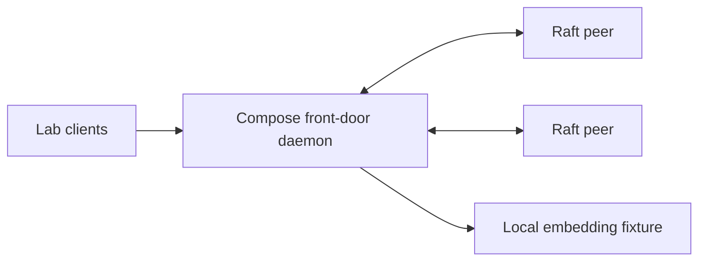

# Compose semantic search scaling: graph-only growth

## Purpose

Measure how client-observed semantic search latency changes as the graph grows but the number of vectors searched remains fixed. See the [benchmark guide](../../../../docs/semantic-search-scaling.md).

## What this test proves

It verifies each graph size and a fixed physical index count, checks index freshness and expected query results, then reports timing. There is no latency threshold.

## Topology

## Scenario phases

The measurement event seeds the first point with indexed documents. At each later point, it adds only same-domain nodes excluded by the index rule, verifies the counts, then warms and measures one and eight clients separately.

## Actors

One semantic-controller principal acts as the scoped writer and reader. The load clients use independently authenticated connections.

## Tunable parameters

The graph targets 1k, 3k, 10k, and 30k nodes. The first point sets the fixed index size. Sample counts and setup, workload, and request bounds are in the manifest.

## Evidence and artifacts

`benchmark/semantic-search-scaling.md` and `.json` show graph nodes and indexed vectors separately. Partial evidence never includes query text or responses.

## Common failure modes

An unexpected change in index count or a freshness failure invalidates the point. Warm-up or timed request failures are kept separate from setup and cleanup failures.

## When to run

Use `mycel-lab run scenario compose-semantic-search-scaling-graph-only --dry-run` for planning. A real run needs explicit approval and disposable Compose resources.
