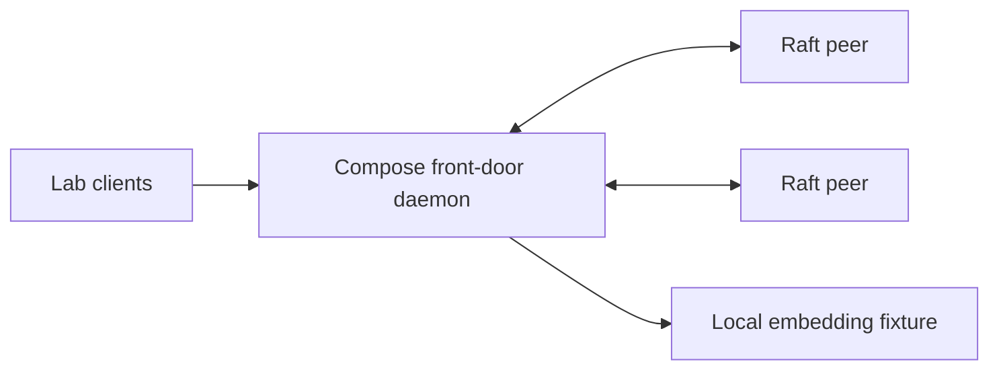

# Compose semantic search scaling: indexed growth

## Purpose

Measure how client-observed semantic search latency changes as one exact index grows. See the [benchmark guide](../../../../docs/semantic-search-scaling.md).

## What this test proves

It verifies the graph and index counts, index readiness, and expected query results before interpreting timing. It reports latency and throughput at each size; it does not prove an algorithmic bound or apply a speed threshold.

## Topology

## Scenario phases

The measurement event incrementally seeds the searched domain, verifies each resulting index, then warms and measures one and eight clients separately.

## Actors

One semantic-controller principal acts as the scoped writer and reader. The load clients use independently authenticated connections.

## Tunable parameters

The baseline targets 1k, 3k, 10k, and 30k indexed records. Sample counts and setup, workload, and request bounds are in the manifest. Treat altered plans as separate experiments.

## Evidence and artifacts

`benchmark/semantic-search-scaling.md` and `.json` retain timing, counts, and incomplete points without storing query text or responses.

## Common failure modes

A failed batch, a stale index, or incorrect top hits makes the point unusable. A workload budget expiry can leave partial samples. Check the run result and cleanup evidence separately.

## When to run

Use `mycel-lab run scenario compose-semantic-search-scaling-indexed --dry-run` for planning. A real run needs explicit approval and disposable Compose resources.
