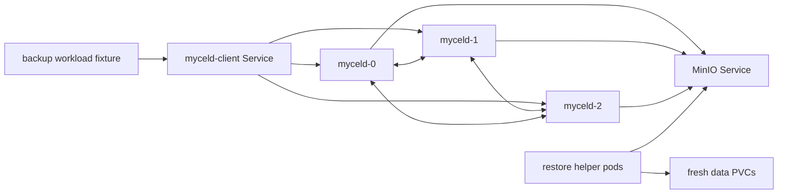

# k3d-cluster-repository-restore

## Purpose

Validates repository-backed cluster backup followed by full PVC replacement and restore in a k3d Kubernetes environment. The scenario exercises the Kubernetes object-store fixture, repository-backed backup capture, PVC replacement safety, restore helper behavior, preserved-identity source fencing, and restored cluster verification.

## What this test proves

- k3d deployments can use the MinIO object-store fixture for repository-backed cluster backups.
- Daemon pods receive object-store credentials through Kubernetes Secret injection while repository metadata stores credential references only.
- A repository-backed backup publishes valid node artifacts, `backup-set.json`, and `COMPLETE` to the shared repository.
- The source StatefulSet is stopped before preserved-identity restore.
- Old PVCs are replaced with fresh PVCs and verified by UID change evidence.
- Restore helper pods restore each ordinal from the repository into an empty target PVC, retry once for transient helper failures, and fail closed if target contents are present.
- The restored StatefulSet boots from restored PVCs and passes workload/fixture verification.

## Topology

## Scenario phases

1. **create-source-fixture**. Writes deterministic source data used for post-restore verification.
2. **configure-minio-repository**. Registers the k3d MinIO-backed repository.
3. **capture-repository-backup**. Starts and waits for repository-backed cluster backup completion.
4. **validate-repository-backup**. Validates completed repository backup-set discovery.
5. **restore-repository-into-fresh-pvcs**. Stops the source StatefulSet, replaces PVCs, restores each ordinal from repository artifacts with one configured helper retry, and restarts the restored StatefulSet.
6. **verify-restored-cluster**. Verifies the restored cluster still contains the deterministic fixture identity.

## Actors

| Actor group | Profile | Count | Role in this scenario |
|---|---|---:|---|
| repository restore fixture actor | graph writer fixture profile | `1` | creates source data whose identity is checked after restore |

## Tunable parameters

| Parameter | Current value/source | Why tune it |
|---|---|---|
| `environment.driver` | `k3d` | Selects Kubernetes/k3d orchestration. |
| `objectStoreFixture` | `minio` | Enables the in-cluster S3-compatible repository fixture. |
| `digestPinnedImagePolicy` | `node-pull` in release bundle | Ensures k3d nodes pull the exact candidate digest. |
| `repositoryId` | scenario target | Change only when testing repository catalog isolation. |
| `prefix` | `mycel-lab/{runID}` | Keeps repository objects isolated per run. |
| `statefulSet` | `myceld` | Identifies target PVC names and source fencing target. |
| `helperRetries` | `1` | Allows one retry for transient helper pod/setup failures while preserving the empty-target proof before every restore attempt. |
| `consolePortBase` | scenario/release-bundle option | Avoids port collisions across destructive scenarios. |

## Evidence and artifacts

- `events.jsonl` records repository creation, backup capture, repository assertions, PVC replacement, restore helper output, and verification payloads.
- `environment/kubernetes-resources.txt`, `pods-describe.txt`, `kubernetes-events.txt`, and pod logs capture Kubernetes state.
- Restore evidence includes old/new PVC UIDs, repository prefix, backup-set ID, helper attempt results, and restored workload verification.
- `post-run-cleanup.json` records k3d cluster/container/network/volume absence checks.

## Common failure modes

- k3d API readiness or local registry mirror issues prevent environment creation.
- MinIO fixture readiness or credential Secret wiring failures prevent repository validation.
- If restored target PVCs are non-empty, helper pods must fail closed instead of clearing data.
- Missing repository artifacts, corrupt manifests, checksum mismatches, or missing `COMPLETE` must block restore.
- Restored daemon boot failures usually indicate raft identity/lineage replay issues, missing encryption material, or incorrect ordinal-to-PVC mapping.

## When to run

Run when changing k3d manifests, object-store fixture rendering, repository-backed backup/restore paths, PVC replacement logic, restore helper behavior, release-gate bundle bindings, or preserved-identity restore safety checks.

## Related files

- YAML: [`k3d-cluster-repository-restore.yaml`](./k3d-cluster-repository-restore.yaml)
- Suite: [`../../suites/k3d-cluster-repository-restore.yaml`](../../suites/k3d-cluster-repository-restore.yaml)
- Release gate: [`../../suites/cluster-release-gate.yaml`](../../suites/cluster-release-gate.yaml)
