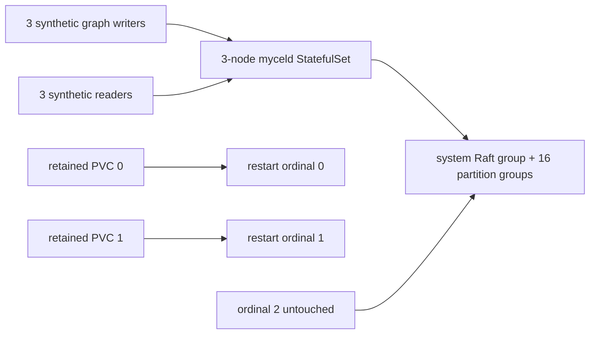

# k3d-commonfolio-procedure-replay-recovery

## Purpose

This is the artifact-backed negative control for MycelDB/mycel#236. It creates a
synthetic CommonFolio-style graph procedure at definition A, updates the same
procedure to definition B, and then restarts retained StatefulSet volumes. The
scenario is intentionally expected to expose the `procedure.create` replay
conflict in Mycel `v0.20.0`.

It is distinct from the #233 scenario: #233 replays an older automation
invocation update, while this scenario replays an older `procedure.create`
record over a newer durable procedure definition.

## What this test proves

- The procedure-create and procedure-update mutations are durably committed.
- The updated procedure and binding are captured before the retained restart.
- Restarted replicas restore the retained Raft state and report authenticated
  readiness diagnostics.
- Mycel `v0.20.0` preserves the expected procedure-create replay blocker and
  incomplete partition readiness.
- The complete synthetic run remains diagnosable from Mycel Lab artifacts.

## Topology



## Negative control

The default image is `myceldb/mycel:v0.20.0`. A valid negative-control run must
preserve a daemon error containing both:

```text
restore raft snapshot and replay committed entries
procedure "commonfolio.page-summary" already exists with different content
```

The run is expected to fail readiness. A TCP listener or Kubernetes `Running`
state is not sufficient: the authenticated readiness and all 17 local Raft
groups must recover before the scenario can pass.

Run the scenario with:

```sh
mycel-lab run suite k3d-commonfolio-procedure-replay-recovery \
  --confirm-destructive \
  --keep-environment-on-failure
```

Do not use staging data or the preserved private volume archive. This scenario
creates its own disposable synthetic state.

## Positive control

After the negative control is captured, run the exact same seed and fixture
against a candidate image by overriding only the daemon image:

```sh
mycel-lab run suite k3d-commonfolio-procedure-replay-recovery \
  --confirm-destructive \
  --image myceldb/mycel:<candidate>
```

The candidate must recover all replicas, report the system group plus all 16
space-partition groups with healthy leaders, preserve the updated procedure,
and contain no replay-blocking log signature.

## Scenario phases

1. Create the CommonFolio-style procedure at definition A and its binding.
2. Update the same procedure and binding to definition B.
3. Generate additional synthetic graph activity while definition B is durable.
4. Capture the updated procedure, binding, and automation state before restart.
5. Restart ordinals 0 and 1 sequentially with retained PVCs; ordinal 2 remains
   untouched.
6. Wait for authenticated readiness and all 17 Raft groups to recover.
7. Capture post-restart diagnostics and scan the complete bounded log window.

Automatic Raft compaction is disabled so the retained restart preserves the
older committed mutation history needed to exercise the replay boundary.

## Actors

| Actor group | Profile | Count | Role |
|---|---|---:|---|
| `graph-writers` | `commonfolio-graph-committer` | `3` | generates synthetic graph mutations |
| `readers` | `gql-reader` | `3` | performs synthetic graph reads |

## Tunable parameters

| Parameter | Current value | Why tune it |
|---|---|---|
| `seed` | `23639139` | Keep fixed for negative/positive A/B comparisons. |
| `clusterOverrides.image` | `myceldb/mycel:v0.20.0` | Expected broken negative control; override for candidates. |
| `clusterOverrides.raft.partitionCount` | `16` | Matches the affected partition shape. |
| `procedureVersion` | `1`, then `2` | Ensures create A and update B are distinct mutations. |
| `cluster-recovery-wait.timeout` | `15m` | Bounds the readiness failure while allowing slow replay diagnostics. |

## Evidence and artifacts

The normal Mycel Lab run artifacts preserve:

- `resolved-scenario.json` with the exact seed, image, phases, and partition count;
- `events.jsonl` with procedure A/B command results and readiness diagnostics;
- actor acknowledgements and read checks for the synthetic graph workload;
- Kubernetes resources, pod descriptions, current and previous-container logs;
- cluster and final oracle reports, including incomplete readiness on failure;
- procedure, binding, and automation-run diagnostics captured before restart.

No private staging data or PVC content is used.

## Common failure modes

- A missing `myceldb/mycel:v0.20.0` image can fail before the procedure fixture
  exists; verify registry access first.
- A TCP health check can pass while cluster readiness remains false; use the
  authenticated readiness and Raft-group artifacts.
- If the procedure update is not visible in the pre-restart diagnostics, the
  fixture is invalid and the run must not be used as the negative control.
- The existing #233 scenario must not be substituted: its blocker is an
  invocation update, not a procedure create.

## When to run

Run the negative control first, before making daemon changes. Then run the same
scenario and seed against each candidate image after the negative-control
artifacts are reviewed.

## Related

- MycelDB/mycel#236
- MycelDB/mycel#233
- YAML: [`k3d-commonfolio-procedure-replay-recovery.yaml`](./k3d-commonfolio-procedure-replay-recovery.yaml)
- Suite: `tests/reliability/suites/k3d-commonfolio-procedure-replay-recovery.yaml`
