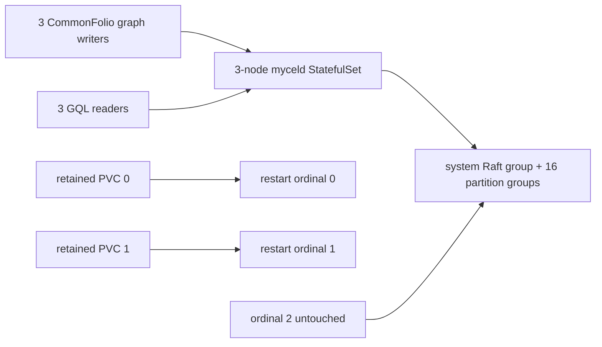

# k3d-commonfolio-stale-replay-recovery

## Purpose

Reproduces and guards the retained-PVC cluster recovery failure tracked by
MycelDB/mycel#233. The scenario creates terminal CommonFolio-style automation
invocation state, then restarts two StatefulSet ordinals one at a time while the
third ordinal remains untouched. Every restarted daemon must replay its retained
Raft log without allowing an older invocation mutation to block partition-group
startup.

This scenario deliberately disables automatic Raft compaction. The daemon loads
the terminal materialized invocation state from its retained PVC and then replays
the older committed invocation transitions still present in the Raft log. That
is the operational shape that exposed the stale replay defect.

## What this test proves

- Terminal automation invocation state exists before any restart.
- Ordinals 0 and 1 can restart sequentially from retained PVCs while ordinal 2
  remains admitted and untouched.
- Authenticated readiness recovers on every replica.
- The system group and all 16 partition groups are present, healthy, and have a
  leader on every replica.
- At least one graph transaction is acknowledged and one graph read succeeds in
  the post-recovery phase.
- Final live node and edge counts exactly match the operations in acknowledged
  transactions for every writer assignment.
- Candidate logs contain none of the known stale-replay blocker signatures over
  the complete bounded replay window, rather than only a trailing line sample.

## Topology



## Negative and positive controls

The reproduction commit uses `myceldb/mycel:v0.19.3`. A valid negative-control
run must fail after proving terminal invocation state existed before restart and
must preserve a replay blocker such as:

```text
restore raft snapshot and replay committed entries
handler=automation: stale automation invocation update
```

Run the identical scenario and seed with `myceldb/mycel:v0.19.4` or a later
candidate for the positive control by overriding only the resolved daemon image:

```sh
mycel-lab run suite k3d-commonfolio-stale-replay-recovery \
  --confirm-destructive \
  --image myceldb/mycel:v0.19.4
```

The positive run must recover all replicas, report the exact `system` plus
`space-partition-0` through `space-partition-15` identity set with healthy
leaders, retain acknowledged graph nodes and edges, make post-recovery workload
progress, and contain no replay-blocker log signature.

Do not treat a TCP listener or Kubernetes `Running` state as recovery. The
`cluster-recovery-wait` event invokes the daemon's authenticated readiness check
and inspects all local Raft group diagnostics on every ordinal.

## Scenario phases

1. Install page-summary-style procedures and bindings for all three writers.
2. Generate graph and automation activity.
3. Require at least one durable terminal invocation per writer assignment.
4. Restart ordinals 0 and 1 sequentially with retained PVCs; ordinal 2 remains
   untouched.
5. Allow up to 15 minutes for all three nodes and the exact 17-group identity
   set to recover.
6. Continue graph reads and writes and require acknowledged-write/successful-read
   progress.
7. Collect invocation diagnostics, scan all current pod logs from the bounded
   20-minute replay window, and reject replay-blocker signatures.
8. Stop actors, compare live node and edge counts with acknowledged operations,
   and fail on any convergence or acknowledged-loss mismatch.

## Actors

| Actor group | Profile | Count | Rate knobs | Role in this scenario |
|---|---|---:|---|---|
| `graph-writers` | `commonfolio-graph-committer` | `3` | `commitsPerSecond` | creates graph changes and automation invocation history |
| `readers` | `gql-reader` | `3` | `queriesPerSecond` | validates reads against writer-owned spaces and domains |

## Tunable parameters

| Parameter | Current value/source | Why tune it |
|---|---|---|
| `seed` | `23339139` | Keep fixed for A/B comparison; change only to explore another schedule. |
| `clusterOverrides.image` | `myceldb/mycel:v0.19.3` | Broken negative control; use `--image` for a positive candidate run. |
| `clusterOverrides.raft.partitionCount` | `16` | Matches the affected deployment shape. |
| `commonfolio-automation-await-terminal.target.minimumPerAssignment` | `1` | Raises the required durable terminal-state fixture strength. |
| `cluster-recovery-wait.target.timeout` | `15m` | Accommodates the observed slow system-Raft startup while strictly bounding failure. |
| `cluster-recovery-wait.target.commandTimeout` | `10s` | Prevents one stuck ordinal inspection from consuming the complete recovery window. |
| `log-assert-absent.target.since` | `20m` | Covers the complete retained-PVC replay window, including a full 15-minute recovery wait. |
| `actorGroups[].rate` | YAML actor group rates | Increase to generate more replayable automation history. |

## Evidence and artifacts

- `resolved-scenario.json` records the exact image, seed, partition count, and
  phases.
- `events.jsonl` records terminal invocation IDs/statuses and per-node
  readiness/Raft diagnostics, including partial diagnostics on event failure.
- `actors/acknowledged-commits.jsonl` and `actors/read-checks.jsonl` preserve
  graph workload evidence.
- `environment/kubernetes-resources.txt`, `environment/pods-describe.txt`,
  `environment/pod-logs-all.txt`, and best-effort previous-container logs
  preserve Kubernetes evidence.
- `oracle/cluster-report.json` and `oracle/final-report.json` are collected even
  after an event-driven failure once the environment has been provisioned. The
  final report records gating `assertionsOk` status plus expected and actual node
  and edge counts per writer. Its legacy `ok` observation also includes
  historical operation failures during expected degradation and is diagnostic,
  not the declared final-assertion verdict.

No private staging data or PVC content is used.

## Common failure modes

- On `v0.19.3`, restarted replicas can reject an older automation invocation
  update as stale, remain unadmitted, and leave partition groups without leaders.
- A missing image can fail cluster creation or pod startup before the fixture is
  established; verify registry access or import the image into k3d.
- Missing inference profile configuration is acceptable when invocations reach a
  durable terminal `failed` state; the test targets replay, not model execution.
- A Kubernetes `Running` pod can still be unusable. Use the recorded readiness
  error and Raft-group payload rather than pod phase alone.

## When to run

Run the negative control when validating the reproduction itself. Run the same
scenario against `v0.19.4` and every release candidate after changes to
automation replay, Raft startup/replay, persisted invocation state, retained-PVC
recovery, readiness, or partition-group lifecycle behavior.

## Related files

- MycelDB/mycel#233
- MycelDB/mycel#188
- MycelDB/mycel#189
- MycelDB/mycel-lab#39
- YAML: [`k3d-commonfolio-stale-replay-recovery.yaml`](./k3d-commonfolio-stale-replay-recovery.yaml)
- Suite: `tests/reliability/suites/k3d-commonfolio-stale-replay-recovery.yaml`
- Related scenario: `k3d-commonfolio-upgrade-replay`
