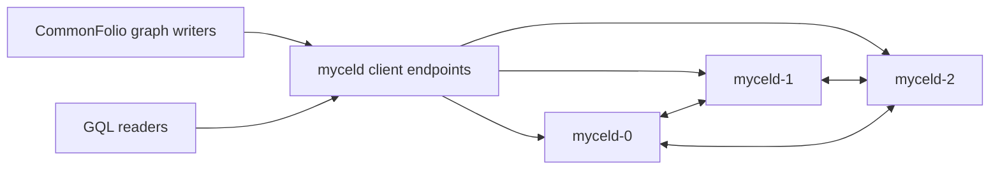

# k3d-commonfolio-upgrade-replay

## Purpose

Provides an end-to-end CommonFolio-style guardrail for automation and graph Raft replay across pod restart and StatefulSet image upgrade. It complements deterministic daemon unit tests for stale automation invocation and superseded graph commit replay.

## What this test proves

- A three-node k3d Mycel cluster can run CommonFolio-like graph writer/reader workload while automation procedures and bindings are installed.
- Restart and image upgrade workflows recover to a healthy shared cluster identity.
- Acknowledged graph transactions are not lost and final counts converge after restart/upgrade.
- Pod logs do not contain known replay blockers: `stale automation invocation update`, `handler=graph: graph conflict`, or `restore raft snapshot and replay committed entries`.

## Topology

## Scenario phases

1. **configure-commonfolio-automation** — installs page-summary-like procedures and per-writer graph automation bindings.
2. **seed-commonfolio-graph-and-invocations** — writes CommonFolio-like page/page-entry graph data to create automation invocation state.
3. **restart-with-commonfolio-state** — restarts one pod while graph and automation state exist.
4. **commonfolio-style-db-image-upgrade** — updates `statefulset/myceld` to the target image and waits for rollout/readiness.
5. **post-upgrade-commonfolio-validation** — continues graph reads/writes and requires convergence.
6. **collect-replay-diagnostics** — captures automation procedure/binding/invocation diagnostics and asserts replay-blocker log strings are absent.

## Actors

| Actor group | Profile | Count | Rate knobs | Role in this scenario |
|---|---|---:|---|---|
| `graph-writers` | `commonfolio-graph-committer` | `3` | `commitsPerSecond` | writes CommonFolio-like graph transactions |
| `readers` | `gql-reader` | `3` | `queriesPerSecond` | performs read checks against writer-owned spaces/domains |

## Tunable parameters

| Parameter | Current value/source | Why tune it |
|---|---|---|
| `seed` | `39139` | Change only when intentionally exploring a different deterministic schedule. |
| `clusterOverrides.image` | `myceldb/mycel:v0.19.2` | Baseline image before the upgrade. |
| `statefulset-image-upgrade.target.image` | `myceldb/mycel:v0.19.3` | Target daemon image; override for local fix validation. |
| `commonfolio-automation-seed.target.limit` | `3` | Number of writer assignments that receive automation config. |
| `phases[].duration` | YAML phase durations | Lengthen to accumulate more automation/graph state or shorten for smoke/debug loops. |
| `actorGroups[].rate` | YAML actor group rates | Increase to stress replay-sensitive state; decrease to isolate environment failures. |

## Evidence and artifacts

- `events.jsonl` contains CommonFolio automation seeding/diagnostics payloads, upgrade event output, and log assertion results.
- `actors/acknowledged-commits.jsonl` and `actors/read-checks.jsonl` provide graph workload evidence.
- `environment/pod-logs.txt`, `environment/kubernetes-resources.txt`, and `environment/pods-describe.txt` capture Kubernetes diagnostics.
- `oracle/cluster-report.json` and `oracle/final-report.json` contain final health, identity, convergence, and graph-loss checks.
- `resolved-scenario.json` records the exact image, actor, phase, and event configuration used.

## Common failure modes

- Missing local or registry images can cause rollout failures; k3d imports local images when the target image exists locally.
- Missing inference profile configuration is acceptable for this guardrail when invocations fail durably after being created; the scenario focuses on replay/readiness behavior.
- Readiness failures after restart/upgrade should be investigated with pod logs and the forbidden replay strings above.
- Graph correctness failures should be debugged from `actors/`, `events.jsonl`, and `oracle/` before rerunning.

## When to run

Run after changes to automation Raft replay, graph Raft replay/deduplication, StatefulSet upgrade handling, k3d image handling, or before releasing daemon fixes for restart/upgrade replay issues.

## Related files

- YAML: [`k3d-commonfolio-upgrade-replay.yaml`](./k3d-commonfolio-upgrade-replay.yaml)
- Suite: `tests/reliability/suites/k3d-commonfolio-upgrade-replay.yaml`
