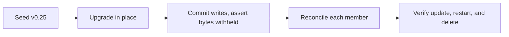

# k3d graph usage upgrade

## Purpose

Qualify the `graph.logical_bytes` backfill when graph writes resume before reconciliation on a v0.25-to-v0.26 upgrade.

## What this test proves

The new metric is withheld rather than returned as a partial value or zero until explicit reconciliation. The byte total is exact after backfill and continues tracking committed payload changes across restart. Physical observations remain diagnostic.

## Topology

Three k3d Raft members start on the official Mycel v0.25.0 image index, then roll forward without replacing their StatefulSet PVCs. Usage checks query **all three daemons**, separately for the fixture domain and its parent space.

## Scenario phases



| Checkpoint | Payload byte calculation | Required behavior |
| --- | --- | --- |
| v0.25 legacy | `abcdef` (6) + nested payload (14) = 20 | Both scopes have two nodes and healthy legacy accounting. `graph.logical_bytes` is unregistered. |
| Upgraded, after create and shrink | `x` (1) + nested payload (14) + `new` (3) = 18 | Both scopes have three nodes. The byte metric is absent with a backfill blocker, and `require_quota_safe` returns `FailedPrecondition`. No reconciliation is requested at this checkpoint. |
| Explicit space reconciliation | `1 + 14 + 3 = 18` | Reconcile on each caught-up daemon. Both strict snapshots now return 18 bytes with `RAFT_COMMITTED_EXACT`, `quota_safe=true`, and `hard_limit_eligible=false`. Reconciliation is ready with no drift. |
| Update and restart | `rené` (5) + 14 + 3 = 22 | Strict snapshots return 22 bytes before and after restart, without relying on reconciliation to repair the read. |
| Delete the new node | `5 + 14 = 19` | Strict snapshots return 19 bytes. A **separate** diagnostic request checks that `diagnostic.local_graph_store_bytes` is approximate and not quota-safe; its byte value is not compared with the logical total. |

The nested payload contributes `世界` (6), `é` (2), `true` (4), `42` (2), and `null` (0). Object keys and syntax are intentionally excluded.

## Actors

`usage-fixture` is a single provisioned graph actor with no background workload. Only phase events mutate its graph, keeping expected usage independent of actor timing.

## Tunable parameters

- `statefulset-image-upgrade.target.image`: use the exact candidate digest before the stable target tag exists.
- `consolePortBase`: the first of three dedicated gRPC forward ports; default `39401`.
- `rolloutTimeout` and `cluster-recovery-wait.target.timeout`: adjust for slower local hosts without weakening readiness or zero-apply-lag checks.

## Evidence and artifacts

`events.jsonl` records the expected per-payload contributions and total, returned snapshots per daemon and scope, the strict-read status while pending, and reconciliation health. The scenario rejects drift reported by live health; it does not tamper with counters or PVC contents to inject drift.

## Common failure modes

- Image pulls fail if a candidate digest is not reachable from the k3d nodes.
- A missing legacy counter, a byte value reported while pending, or divergence between members fails the matching checkpoint and retains the observed snapshots.
- The run fails if space reconciliation does not make quota-safe reads complete for both scopes on every member.

## When to run

From the Mycel Lab checkout:

```sh
mycel-lab run suite k3d-graph-usage-upgrade --dry-run
```

The maintained scenario targets `docker.io/myceldb/mycel:v0.26.0`. Before that tag exists, render a temporary scenario with only `statefulset-image-upgrade.target.image` replaced by the candidate's registry digest. The baseline image stays pinned. For example, set `CANDIDATE_IMAGE` to the complete `registry/repository@sha256:…` reference, then run:

```sh
scenario=$(mktemp "${TMPDIR:-/tmp}/mycel-usage-upgrade.XXXXXX")
trap 'rm -f "$scenario"' EXIT
source=tests/reliability/scenarios/k3d-graph-usage-upgrade/k3d-graph-usage-upgrade.yaml
python3 - "$source" "$scenario" "$CANDIDATE_IMAGE" <<'PY'
from pathlib import Path
import re
import sys

source, output, image = sys.argv[1:]
if not re.fullmatch(r'[^\s@]+@sha256:[0-9a-f]{64}', image):
    raise SystemExit('CANDIDATE_IMAGE must be a named sha256 image reference')
text = Path(source).read_text()
marker = 'image: docker.io/myceldb/mycel:v0.26.0'
if text.count(marker) != 1:
    raise SystemExit('expected one upgrade image marker')
Path(output).write_text(text.replace(marker, 'image: "' + image + '"'))
PY
mycel-lab run scenario-file "$scenario" --dry-run \
  --profile-dir "$PWD/tests/reliability/clusters" \
  --profile-dir "$PWD/tests/reliability/actor-profiles"
```

After operator approval, replace `--dry-run` with `--confirm-destructive` and retain the resulting artifact directory. This creates and then deletes a local k3d cluster; both images must be pullable by the k3d nodes. Record the source and target digests with the evidence. This suite is separate from `cluster-release-gate`: the standard release bundle pins one daemon image, whereas this scenario deliberately requires two distinct images. It does not replace protected cluster acceptance.
