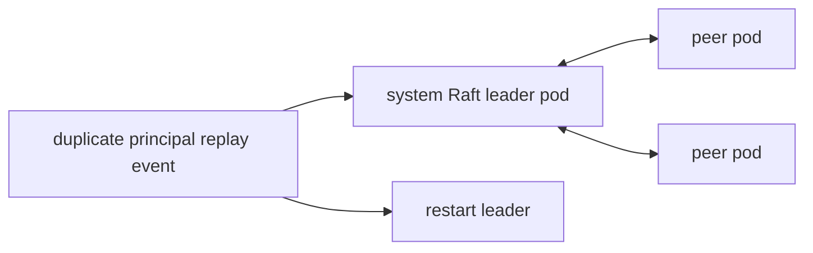

# k3d-identity-raft-replay-recovery

## Purpose

Reproduces the identity Raft replay failure tracked by MycelDB/mycel#172 and validates duplicate-principal tail replay recovery after snapshot restore and node restart.

## What this test proves

- A duplicate-principal command that fails live with `principal already exists` can be present in the committed Raft tail.
- After a system-Raft snapshot and node restart, startup replay treats that committed application-error outcome as replay-safe.
- The restarted pod returns to readiness and the three-node cluster converges to healthy shared identity.

## Topology

## Scenario phases

1. **bootstrap** — allow the cluster and bootstrap identity to settle.
2. **duplicate-principal-tail-and-restart** — snapshot the system-Raft leader, submit the duplicate principal command, and restart that node.
3. **post-restart-health** — wait for final cluster health convergence.

## Actors

| Actor group | Profile | Count | Rate knobs | Role in this scenario |
|---|---|---:|---|---|
| `idle` | `noop` | `1` | `commitsPerSecond` = `1` | keeps the scheduler active without graph workload |

## Tunable parameters

| Parameter | Current value/source | Why tune it |
|---|---|---|
| `seed` | `40404` | Change only when intentionally exploring a different deterministic schedule. |
| `clusterOverrides.raft.partitionCount` | `4` | Keeps the scenario focused and fast while preserving clustered behavior. |
| `identity-duplicate-principal-replay.target.username` | `admin` | The principal to duplicate during the replay-tail fixture. |
| `identity-duplicate-principal-replay.target.settle` | `2s` | Allows the rejected duplicate command to settle before restart. |

## Evidence and artifacts

- `events.jsonl` records the snapshot, duplicate-principal command, and restart event payloads.
- `environment/pod-logs.txt`, `environment/kubernetes-resources.txt`, and `environment/pods-describe.txt` capture Kubernetes diagnostics.
- `oracle/cluster-report.json` records final cluster identity and health convergence.
- `resolved-scenario.json` records the exact cluster and event configuration used.

## Common failure modes

- A broken daemon restores the snapshot and replays the duplicate-principal tail entry during startup, causing readiness failure with `principal already exists`.
- Missing k3d/kubectl prerequisites or stale clusters can prevent environment creation.
- Cluster health convergence failures should be debugged from pod logs, `events.jsonl`, and `oracle/cluster-report.json`.

## When to run

Run after changes to identity Raft replay, system snapshot/compaction behavior, duplicate application-error handling, or release validation for replay recovery fixes.

## Related files

- YAML: [`k3d-identity-raft-replay-recovery.yaml`](./k3d-identity-raft-replay-recovery.yaml)
- Suite: `tests/reliability/suites/k3d-identity-raft-replay-recovery.yaml`
