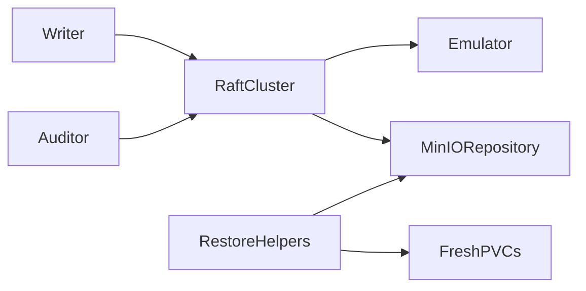

# k3d-procedure-inference-backup-restore

## Purpose

Repository-backed system backup/restore acceptance for procedure-inference ledgers, watermarks, run references, and control state.

## What this test proves

A backed-up terminal attempt, immutable event IDs/change watermarks, typed run reference, exact system-fixture identities/counts, and the completed disabled control-barrier identity survive a repository-backed restore into fresh PVCs. A post-backup attempt is absent after restore; a mutation remains excluded while restored-disabled with zero emulator calls, re-enable itself creates no call, and the following mutation permits exactly one new attempt and provider call.

The scenario also proves that procedure-inference recovery no longer depends on daemon-local backup directories: durable artifacts are `backup-set.json`, `COMPLETE`, and per-node archives in the MinIO repository fixture.

## Topology

A disposable three-node k3d Raft cluster, internal generation emulator, MinIO backup repository fixture, and fresh restored PVCs.



## Scenario phases

Provision/configure, create one attempt, complete a disable barrier, configure a MinIO repository, and capture a repository-backed system backup. Then enable and create a post-backup negative control, reset/restore fresh PVCs from repository artifacts, compare exact backed-up identities/watermarks, prove disabled-work exclusion and zero provider effects, re-enable, prove the enable transition itself remains at zero effects, create one new attempt and provider call, verify diagnostics, and delete the repository backup set through the public admin path.

## Actors

An ordinary graph writer triggers work; a distinct automation/inference audit actor reads sanitized evidence and controls.

## Tunable parameters

All provider, poll, backup, restore, health, and attempt budgets are finite. The expected restored attempt count is exactly one. The MinIO repository ID, bucket, prefix, capture provider, and restore helper retry count are scenario target knobs.

## Evidence and artifacts

Sanitized attempt/change/run assertions, in-memory ledger and control-barrier checkpoints, exact restored system-fixture counts/identities, repository backup metadata, restore helper output, emulator digest/category observations, image provenance, repository delete proof, and redaction output. This does not claim that principal-scoped user exports contain system inference ledgers.

## Common failure modes

Loss of backed-up evidence, retention of the post-backup attempt, watermark/history gaps, run-reference mismatch, incomplete repository restore, missing/corrupt repository artifacts, extra provider work, or unsafe artifacts fail closed.

## When to run

Use the dry-run for validation. Real execution replaces disposable k3d storage and requires fresh approval plus `--confirm-destructive`:

```sh
mycel-lab run suite-file tests/reliability/suites/k3d-procedure-inference-backup-restore.yaml --dry-run
```
