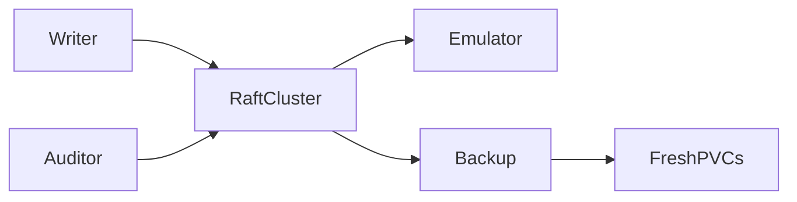

# k3d-procedure-inference-backup-restore

## Purpose

System backup/restore acceptance for procedure-inference ledgers and control state.

## What this test proves

A backed-up terminal attempt, immutable event IDs/change watermarks, typed run reference, and a completed disabled control state survive restore. A post-backup attempt is absent after restore; a mutation remains excluded while restored-disabled, and explicit re-enable permits exactly one new attempt.

## Topology

A disposable three-node k3d Raft cluster, internal generation emulator, and system-backup fixture storage.



## Scenario phases

Provision/configure, create one attempt, complete a disable barrier, and capture a system backup. Then enable and create a post-backup negative control, reset/restore fresh PVCs, compare exact backed-up identities/watermarks, prove disabled-work exclusion, re-enable for one new attempt, verify diagnostics, and remove the sensitive host backup directory.

## Actors

An ordinary graph writer triggers work; a distinct automation/inference audit actor reads sanitized evidence and controls.

## Tunable parameters

All provider, poll, backup, restore, health, and attempt budgets are finite. The expected restored attempt count is exactly one.

## Evidence and artifacts

Sanitized attempt/change/run assertions, in-memory cross-boundary checkpoints, system-backup metadata, restore output, emulator digest/category observations, image provenance, backup-host cleanup proof, and redaction output. This does not claim that principal-scoped user exports contain system inference ledgers.

## Common failure modes

Loss of backed-up evidence, retention of the post-backup attempt, watermark/history gaps, run-reference mismatch, incomplete restore, extra provider work, or unsafe artifacts fail closed.

## When to run

Use the dry-run for validation. Real execution replaces disposable k3d storage and requires fresh approval plus `--confirm-destructive`:

```sh
mycel-lab run suite-file tests/reliability/suites/k3d-procedure-inference-backup-restore.yaml --dry-run
```
