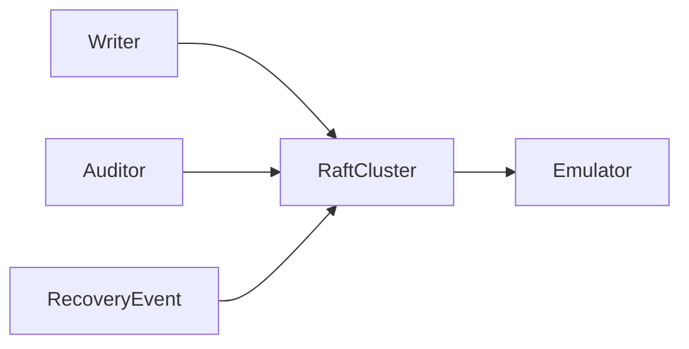

# k3d-procedure-inference-recovery

## Purpose

Clustered restart/replay acceptance for authoritative procedure-inference evidence.

## What this test proves

One terminal emulator-backed attempt, immutable changes, typed run references, and publication identity survive a node restart. A later graph event produces exactly one additional attempt without duplicate provider work.

## Topology

A disposable three-node k3d Raft cluster and an internal generation-emulator Service.



## Scenario phases

Provision/configure, trigger and observe the first terminal attempt, restart one node, assert stable cluster recovery, refresh the affected per-node host tunnel, prove readiness through the same external authenticated gRPC path, re-read retained evidence, trigger a second event, and reconcile emulator observations and bounded diagnostics.

## Actors

An ordinary graph writer triggers work; a distinct automation/inference audit actor reads sanitized evidence and controls.

## Tunable parameters

All restart, health, poll, request, token, page, and attempt budgets are finite and declared in the scenario/provider profile.

## Evidence and artifacts

Sanitized attempt/change/run assertions, restart results, bounded endpoint generation/reconnection/gRPC-probe evidence, stable emulator digests/categories, image provenance, cluster reports, and redaction output.

## Common failure modes

Missing retained evidence, changed event IDs, history gaps, duplicate attempts, missing run references, extra provider calls, unstable Raft recovery, a stale or unready external endpoint generation, or unsafe artifacts fail the run. Only the idempotent readiness probe is retried; graph mutations and provider operations are never retried by endpoint recovery.

## When to run

Use the dry-run for validation. Real execution changes a disposable k3d environment and requires fresh approval plus `--confirm-destructive`:

```sh
mycel-lab run suite-file tests/reliability/suites/k3d-procedure-inference-recovery.yaml --dry-run
```
