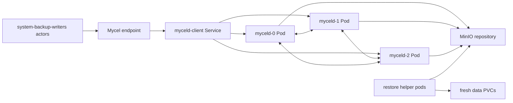

# k3d-system-backup-restore

## Purpose

Validates full-system backup and restore in Kubernetes using the repository-only backup contract. It creates live graph data, registers a MinIO-backed repository with credential references, captures a repository-backed backup set, validates repository-truth metadata, replaces PVCs, restores each ordinal from repository artifacts, and verifies restored authentication and data access.

## What this test proves

- k3d deployments can publish durable system backup artifacts to an external S3-compatible repository rather than daemon-local backup directories.
- Backup operations reach a completed daemon state with raft/convergence evidence before restore begins.
- Repository validation proves the backup set has `backup-set.json`, `COMPLETE`, and expected per-node artifacts before PVC replacement.
- Restore helper pods restore each ordinal from the repository into freshly-created, empty target PVCs and fail closed if the target is not empty.
- Restored users can authenticate and query data written before the backup.

## Topology

## Scenario phases

1. **create-workload-fixture**. Writes deterministic graph/blob data that must be present after restore.
2. **configure-minio-repository**. Creates the dev-only MinIO repository using credential references only.
3. **capture-and-validate-backup**. Starts a repository-backed deployment backup and validates the completed backup set through repository-truth APIs.
4. **restore-into-fresh-pvcs**. Stops the StatefulSet, replaces PVCs, and runs repository restore helper pods for every ordinal.
5. **verify-restored-cluster**. Verifies the restored cluster identity, health, authentication, and source fixture counts.

## Actors

| Actor group | Profile | Count | Rate knobs | Role in this scenario |
|---|---|---:|---|---|
| `system-backup-writers` | `graph-committer` | `1` | `commitsPerSecond` = `0.0001` | writes graph transactions |

## Tunable parameters

| Parameter | Current value/source | Why tune it |
|---|---|---|
| `seed` | `29292` | Change only when intentionally exploring a different deterministic schedule. |
| `environment.driver` | `k3d` | Selects the Kubernetes/k3d orchestration backend. |
| `objectStoreFixture` | `minio` | Enables the in-cluster S3-compatible repository fixture. |
| `repositoryId` | `mycel-lab-system-minio` | Change only when testing repository catalog isolation. |
| `prefix` | `mycel-lab/{runID}` | Keeps repository objects isolated per run. |
| `captureProvider` | `filesystem_immutable_copy` | Exercises the portable repository capture path. |
| `statefulSet` | `myceld` | Identifies target PVC names and source fencing target. |
| `helperRetries` | `1` | Allows one retry for transient helper setup failures while preserving the empty-target proof before every restore attempt. |

## Evidence and artifacts

- `result.json` is the first stop: it records phase status, duration, and terminal pass/fail state.
- `events.jsonl` records repository creation, backup capture, validation, PVC replacement, restore helper output, and restored workload verification.
- Restore evidence includes old/new PVC UIDs, repository prefix, backup-set ID, helper attempt results, and restored workload verification.
- `resolved-scenario.json` confirms the exact cluster profile, actor profiles, and overrides used for the run.
- `summary.md` gives a short human-readable run report suitable for PR comments.
- `manifests/myceld.yaml`, `environment/kubernetes-resources.txt`, `environment/pods-describe.txt`, and pod logs explain k3d/Kubernetes failures.
- `oracle/` artifacts, when present, contain final consistency and cluster-health evidence.

## Common failure modes

- Missing k3d/kubectl prerequisites, stale clusters, or namespace cleanup problems prevent environment creation.
- MinIO fixture readiness or credential Secret wiring failures prevent repository validation.
- Pod readiness, PVC, or service rendering errors appear in `environment/kubernetes-resources.txt` and `environment/pods-describe.txt`.
- If restored target PVCs are non-empty, helper pods must fail closed instead of clearing data.
- Missing repository artifacts, corrupt manifests, checksum mismatches, or missing `COMPLETE` must block restore.
- Graph correctness failures should be debugged from `actors/`, `events.jsonl`, and `oracle/` before rerunning.

## When to run

Run before backup/restore releases and after changes to repository-backed backup orchestration, PVC rendering, restore helper behavior, auth, or graph durability.

## Related files

- YAML: [`k3d-system-backup-restore.yaml`](./k3d-system-backup-restore.yaml)
- Suite: [`../../suites/k3d-system-backup-restore.yaml`](../../suites/k3d-system-backup-restore.yaml)
- Release gate: [`../../suites/cluster-release-gate.yaml`](../../suites/cluster-release-gate.yaml)
